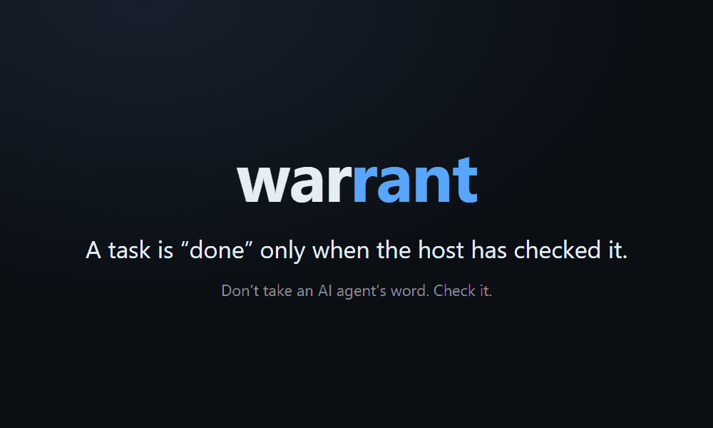
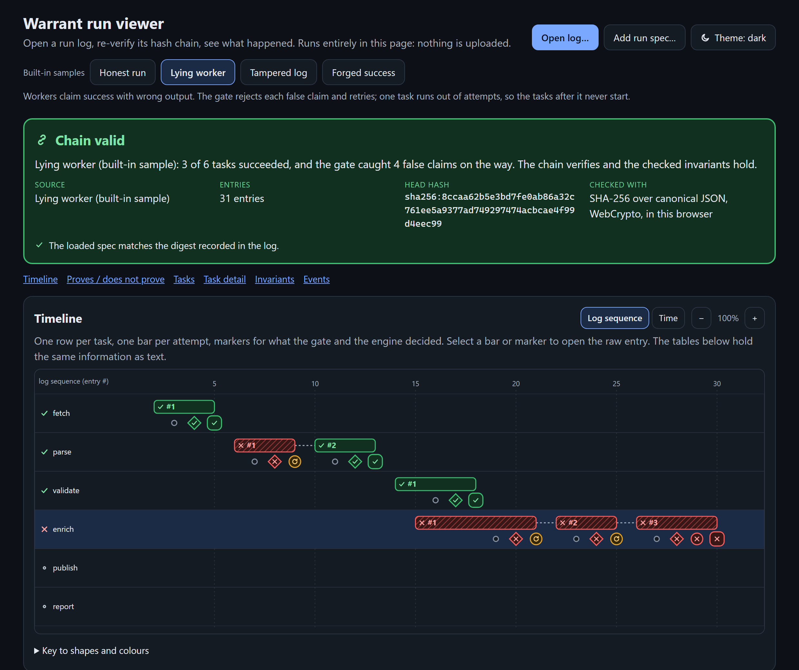
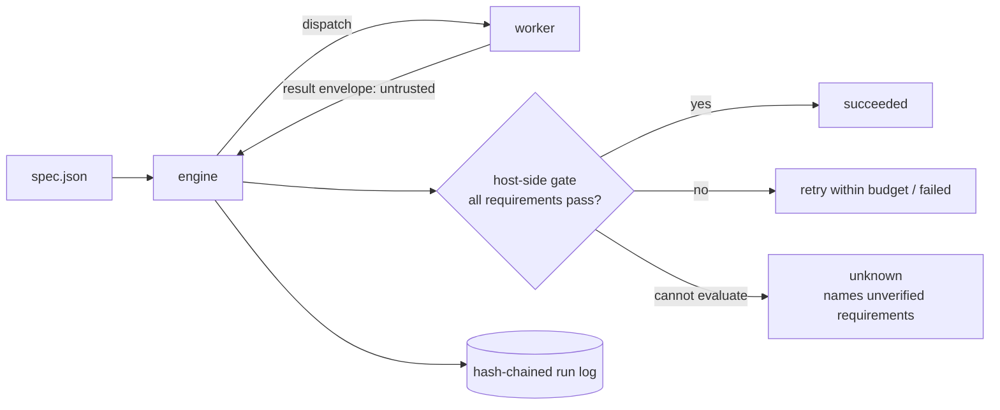

# warrant

[](https://github.com/Ujjwaljain16/Warrant/actions/workflows/ci.yml)


**Don't take an AI agent's word that it's done. Check it.**

When an agent, a script or a tool-using model reports "done", most orchestrators believe it. Under real failure
conditions (crashes mid-effect, hung tools, duplicate delivery, cancellation, and models that are simply wrong) that
is not evidence. `warrant` runs a DAG of tasks and marks one `succeeded` only after the **host** has checked its output
against requirements the spec author wrote. Every state change goes into a hash-chained, crash-recoverable log that can
be re-audited later, and an irreversible action is never repeated on a guess.

It also ships the means to doubt all of that: a deterministic fault-injection benchmark, and a study of real models
whose "done" claims were checked by hidden tests in a Docker sandbox. Both report where the approach loses.



<sub>Terminal panes are condensed from the real output of the commands; [how the demo is made](tools/demo/README.md).</sub>

## Results

**Simulated workers: 125,000 runs, held-out seeds, 500 paired trials per cell.** Closest baseline: same deadlines and
retries, but no gate and no deduplication.

| injected fault | metric | closest baseline | **warrant** |
|---|---|---|---|
| workers falsely claim success | wrong results reported as success | 44.2% | **0%** |
| mixed faults | duplicate non-repeatable effects | 19.0% | **0%** |
| duplicate delivery | wrong results reported as success | 10.2% | **0%** |
| crash mid-effect | duplicate non-repeatable effects | 10.4% | **0%** |

The cost is measured too: +49 ms of simulated latency with no faults at all, and 13.5 points *fewer* tasks completed when
non-repeatable work cannot be reconciled, because it refuses to guess. With only a shape check as a requirement, the gate
stops nothing well-formed. [Full tables](docs/BENCHMARK.md).

**Real models: 180 episodes, 30 held-out tasks, router arm.** The agents claimed "done" 136 times and **77 of those claims
were wrong** (56.6%, 95% CI 44.3% to 68.1%). What each check accepted of the wrong ones:

| check | wrong claims accepted |
|---|---|
| trust the agent's claim | 100% (77 of 77) |
| the agent's own visible tests | 72.7% (56 of 77) |
| **warrant's hidden-test gate** | **3.9% (3 of 77), 95% CI 0.0% to 10.1%** |


**The rate depends heavily on the model.** A partial run of `gemini-3.5-flash-lite` (39 episodes, served directly by Google)
had 2 wrong claims in 36 (5.6%, CI 0.0% to 14.7%), against 37.6% and 88.2% for the two router models, so the 57% describes
that pair, not agents in general.

Read these caveats with the numbers. The models were reached through a **third-party router whose model identity is
unverified**. The tasks are 30 small synthetic JavaScript problems, one setting. The protocol's pre-registered primary arm
(direct Gemini API) is only **partially run** because the free tier was overloaded, so the figures above pool the router
arm, which the protocol listed as a separate extra. The three gate misses are named, and the LLM-judge comparison is
inconclusive (142 of 402 judge replies were cut off). [Everything, including the deviations](docs/AGENT_RESULTS.md); generated tables: [router arm](results/agent-claims/final/router-arm/REPORT.md), [all recorded runs](results/agent-claims/final/REPORT.md).

## Try it (no key, no network, no dependencies)

```bash
npm run example         # 3-step pipeline of real subprocesses; every step passes the gate
npm run example:lying   # same pipeline, but `sort` exits 0 with unsorted output: the gate catches it
npm test                # 400+ tests, including a crash-at-every-log-boundary chaos test
npm run check           # syntax, hygiene, secret scan, vendored-file provenance
```

`npm run example:lying` exits 1 and prints a JSON report; the part that matters (trimmed):

```json
"sort":      { "status": "failed",  "code": "GATE_FAILED", "verification": { "failed": ["exact", "is-sorted"] } },
"summarize": { "status": "blocked", "code": "DEPENDENCY_NOT_SUCCEEDED", "attempts": 0 }
```

Each run writes one log under `.warrant/<run_id>/run.log`. Running the same example again says that its log already exists
(`warrant resume` continues a run; delete `.warrant/` to start over).

Re-audit a finished log's hash chain and invariants independently of the engine, or open it in the offline
[run viewer](docs/VIEWER.md) (`viewer/run-viewer.html`, one static file, no server):

```bash
node bin/warrant.js verify-log .warrant/run-pipeline/run.log --spec examples/pipeline/spec.json
```



## How a run works



`succeeded` is reachable only through a gate verdict minted by the host. Workers run with deadlines, bounded classified
retries and deduplicated deliveries; cancellation aborts in-flight work; non-repeatable effects are reconciled, not
retried; `resume` continues from the log after a crash. Design: [ARCHITECTURE](docs/ARCHITECTURE.md),
[THESIS](docs/PROJECT_THESIS.md), [DECISIONS](docs/DECISIONS.md).

## What is in the box

| | |
|---|---|
| **Engine and log** | gated execution, state machine, hash-chained log, `resume`, independent `verify-log`; zero npm dependencies |
| **Simulated benchmark** | 5 policies x 10 fault profiles x 5 workloads, bootstrap CIs, byte-reproducible ([docs](docs/BENCHMARK.md)) |
| **Agent gate** | model-driven `AgentWorker`; hidden tests run in a split-container Docker sandbox; 43 tasks with audit suites ([protocol](docs/AGENT_CLAIMS_PROTOCOL.md), [results](docs/AGENT_RESULTS.md)) |
| **MCP server** | lets a model run human-approved specs by name, and nothing else ([docs](docs/MCP.md)) |
| **Run viewer** | offline HTML that re-verifies the chain and invariants in the browser ([docs](docs/VIEWER.md)) |
| **Multi-agent demo** | planner and parallel workers; gated vs ungated on the same recorded replies ([docs](docs/MULTI_AGENT_DEMO.md)) |

The full capability table, layout and limitations are in [docs/OVERVIEW.md](docs/OVERVIEW.md); a reading order is in
[docs/INDEX.md](docs/INDEX.md).

## Honest limits

- The benchmark's workers are simulated and its fault rates are assumptions. The real-model study is small, synthetic and
  routed through an unverifiable third party; see above.
- The gate is only as strong as the requirements you write. Missing requirements mean missing guarantees.
- Command workers are **not sandboxed** (they run as your user); only model-written code in the agent study runs in Docker.
  [Threat model](docs/THREAT_MODEL.md).
- Verified on Windows 11 and in Linux containers; CI runs on `ubuntu-latest` and `windows-latest`. No macOS run. The MCP server
  was not tested against a live Claude Code session.
- Commit dates in this repository were chosen by the author after the fact and are not a development timeline. Trust the
  tool-written timestamps in run metadata ([audit, section 11](docs/FINAL_AUDIT.md)).

## Attribution

A small subset of [Citadel](https://github.com/SethGammon/Citadel) by Seth Gammon (MIT, revision `16ab6ee`) is vendored
unmodified in `third_party/citadel/`: the canonical-JSON digest helper and the effect-classed, hash-chained journal design
that `src/log/runlog.js` was rewritten from. Everything else is new work in this repository.
[Provenance](docs/UPSTREAM_PROVENANCE.md) lists what was taken and changed; [AUDIT](docs/AUDIT.md) records the upstream defects
found along the way.

License: MIT. See [LICENSE](LICENSE) and [third_party/citadel/LICENSE](third_party/citadel/LICENSE).
