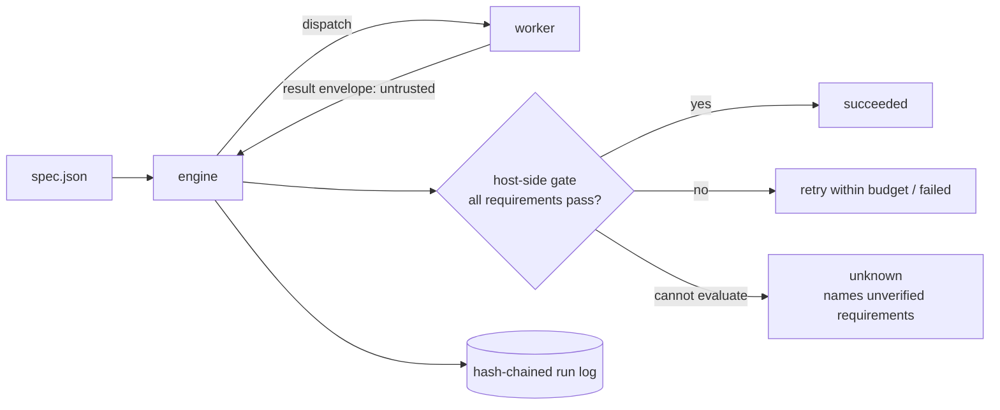

# warrant

**Evidence-gated execution of bounded AI work, with a reproducible fault-injection benchmark.**

When an AI worker (an agent, a script, a tool-using model) reports "done", most orchestrators believe it.
Under real failure conditions (crashes mid-effect, hung tools, malformed output, duplicate delivery,
cancellation) that is not evidence. `warrant` runs a DAG of tasks and only marks a task `succeeded` after the
**host** has checked its output against requirements the spec author wrote, records every state change in a
hash-chained log, and refuses to repeat an irreversible action on a guess.

It also ships the thing that lets you doubt all of that: a deterministic benchmark that compares the approach
against simpler orchestration policies on identical workloads and identical injected faults, and reports where
it loses.

> Status: a focused vertical slice, not a framework. Zero npm dependencies; Node 22+.
> Origin: derived in part from [Citadel](https://github.com/SethGammon/Citadel) (MIT). See
> [Attribution](#attribution-and-what-is-original).

## Quick start (no API key, no network)

```bash
node --version          # 22 or newer
npm run example         # 3-step pipeline of real subprocesses; every step passes the gate
npm run example:lying   # same pipeline, but `sort` exits 0 with unsorted output: the gate catches it
npm test                # 100+ tests incl. crash-at-every-log-boundary chaos test
npm run check           # syntax, hygiene, secret scan, vendored-file provenance
```

`npm run example:lying` exits non-zero and reports which requirements failed:

```
sort:      failed / GATE_FAILED   (requirements failed: exact, is-sorted)
summarize: blocked                (never executed)
```

Verify a log's hash chain and the protocol invariants after the fact:

```bash
node bin/warrant.js verify-log .warrant/run-pipeline/run.log --spec examples/pipeline/spec.json
```

## What it does

| Capability | Status |
|---|---|
| Typed run spec with validation (ids, cycles, limits, forbidden keys) | implemented |
| Task state machine; `succeeded` reachable only through a minted `GateVerdict` | implemented |
| Gate requirements: `artifact_sha256`, `artifact_json`, `command`, `predicate` (host-side) | implemented |
| Bounded concurrency, per-attempt deadlines, classified bounded retries with backoff | implemented |
| Per-attempt result deduplication; late and duplicate deliveries ignored | implemented |
| Effect classes with reconcile-before-retry for `external-nonrepeatable` tasks | implemented |
| Cancellation that aborts in-flight work and waits for workers to stop | implemented |
| Append-only hash-chained run log (fsync, torn-tail repair, single-writer lock) | implemented |
| `resume` from the log; independent `verify-log` invariant audit | implemented |
| Subprocess worker (no shell, scrubbed env, per-attempt dir, kill on deadline/cancel) | implemented |
| Deterministic simulated worker + seeded fault injection | implemented |
| Benchmark: 5 policies x 10 fault profiles x 5 workloads, bootstrap CIs, paired verdicts | implemented |
| Reconcile from receipts for external commands (`ReceiptWorker`, `"exec": {"receipt": true}`): crash-after-effect recovery without repeating the effect | implemented; tested with real subprocesses; limits below |
| Partial-requirements experiment (protocol v2, extension A) | implemented; results in [results/partial-requirements](results/partial-requirements/REPORT.md) |
| Adapter for a specific agent runtime (Claude Code, Codex, ...) | **planned** (the `Worker` interface is the seam; the receipt adapter is a generic command adapter, not an agent integration) |
| Signed log / receipts | planned |
| OS-level sandboxing of workers | planned (see [threat model](docs/THREAT_MODEL.md)) |
| Real-model evaluation (30 held-out tasks, two models via a third-party router, Gemini arm partial) | **done**, see [docs/AGENT_RESULTS.md](docs/AGENT_RESULTS.md); small, synthetic tasks, router model identity unverified |

## How a run works



The full module diagram, state machine, invariants (I1-I8) and recovery semantics are in
[docs/ARCHITECTURE.md](docs/ARCHITECTURE.md). The thesis and non-goals are in
[docs/PROJECT_THESIS.md](docs/PROJECT_THESIS.md); design decisions with evidence are in
[docs/DECISIONS.md](docs/DECISIONS.md).

A minimal task:

```json
{
  "id": "sort", "deps": ["fetch"], "effect": "pure",
  "deadline_ms": 10000, "max_attempts": 2, "outputs": ["out"],
  "exec": { "argv": ["node", "./scripts/sort.js"] },
  "requirements": [
    { "id": "exact",     "kind": "artifact_sha256", "artifact": "out", "sha256": "..." },
    { "id": "is-sorted", "kind": "command", "argv": ["node", "-e", "..."] }
  ]
}
```

A task with no requirements is rejected unless it says `"trust_worker": true`, and such a task is reported as
`CLAIM_ONLY`, never as verified. Full example: [examples/pipeline](examples/pipeline).

## Benchmark

```bash
npm run bench:dev      # development seeds 0..99, ~1 minute, writes results/dev
npm run bench:final    # held-out seeds 10000..10499, ~5 minutes, writes results/final
npm run bench:partial  # protocol v2 extension A, seeds 20000..20499, ~25 seconds, writes results/partial-requirements
node bin/warrant.js report results/final     # regenerate REPORT.md and charts from summary.json
```

### Held-out results (simulated workers; 500 paired trials per cell)

Pooled over five workloads. "Closest baseline" is `naive-parallel-timeout`: same deadlines and retry budget as the gated
engine, but no gate, no per-attempt deduplication, no reconcile. Times are *simulated* milliseconds. Full tables with
95% bootstrap CIs, per-workload results and charts: [results/final/REPORT.md](results/final/REPORT.md).

| fault profile | correct completion: sequential / closest baseline / **gated** | false-success rate | duplicate non-repeatable effects | median makespan |
|---|---|---|---|---|
| none | 1.000 / 1.000 / 1.000 | 0 / 0 / 0 | 0 / 0 / 0 | 1684 / 643 / **703** |
| crash | 0.965 / 0.965 / 0.971 | 0 / 0 / 0 | 0.104 / 0.104 / **0** | 1864 / 770 / **847** |
| crash, no reconcile | 0.965 / 0.965 / **0.830** | 0 / 0 / 0 | 0.104 / 0.104 / 0 | 1864 / 770 / 771 |
| delay and hangs | 0.637 / 0.965 / 0.971 | 0 / 0 / 0 | 0 / 0.153 / **0** | 9870 / 1339 / **1404** |
| false claims | 0.558 / 0.558 / **0.876** | 0.442 / 0.442 / **0** | 0 / 0 / 0 | 1684 / 643 / **843** |
| duplicate delivery | 1.000 / 0.898 / 1.000 | 0 / 0.102 / 0 | 0 / 0 / 0 | 1684 / 643 / **703** |
| mixed faults | 0.609 / 0.658 / **0.856** | 0.217 / 0.291 / **0** | 0.083 / 0.190 / **0** | 3870 / 1066 / **1188** |

What this does and does not show:

- **Where the gated approach wins:** it never reported a wrong result as success (0 false successes in every profile),
  never repeated a non-repeatable effect, never dispatched a task before its dependencies succeeded, and began no effect
  after a cancel request (closest baseline: 1.40 effects per run after cancel).
- **Where it loses, measured:** it is slower in simulated time in every profile that has a gate to pay for (+49 ms with
  no faults at all, up to +157 ms under false claims; CIs exclude zero); with non-repeatable work that cannot be
  reconciled (`crash, no reconcile`) it completes **13.5 points fewer tasks** (-0.135, 95% CI [-0.143, -0.126]) because it
  refuses to guess; and under `cancel` it completes fewer tasks and wastes more tokens by design, since it aborts work in flight.
- **With no faults the gate buys nothing** in correctness and costs time.
- **Much of the gap versus a bare baseline is just timeouts.** Against the closest baseline, the completion gains under
  crash, delay and invalid output are 0.3 to 0.6 points; the real differences there are duplicate effects (10 to 15 points)
  and the false-success and cancel rows.
- The false-claim result holds because the benchmark's requirements are complete (digest equality). Real requirements
  are rarely that strong. The workers are simulated and the fault rates are assumptions.

### Partial requirements (protocol v2, extension A; new held-out seeds 20000..20499, run once)

The results above give the gate complete requirements. This experiment relaxes that on the `false_claim` and `mixed`
profiles, with three requirement sets: `full` (the v1 set), `digest-only` (a pinned sha256 on every task) and
`shape-only` (only a JSON shape check; no content is pinned). Pooled false-success rates, with the closest baseline
(`naive-parallel-timeout`, which ignores requirements and so is identical across sets):

| profile | baseline | gated, `full` | gated, `digest-only` | gated, `shape-only` |
|---|---|---|---|---|
| false claims | 0.441 | 0 | 0 | **0.441** (same false-success and correct counts as the baseline on every one of the 2,500 paired runs) |
| mixed faults | 0.290 | 0 | 0 | **0.254** [0.243, 0.266] |

- With a shape check alone the gate stops nothing that is well-formed: under `false_claim` gated is exactly as wrong as the
  baseline (false-success difference 0.000, CI [0, 0]) and also slower (+28 simulated ms on average).
- Under `mixed` the shape check still rejects malformed and missing outputs, so gated is modestly better than the baseline
  (false-success -0.036, correct completion +0.043, both CIs exclude 0) but far from the 0 it reaches with a pinned digest.
- One metric moves the wrong way and is reported as such: `unsafe final status` (wrong tasks reported as succeeded, over all
  wrong tasks) is +0.010 *worse* for gated than the baseline under `mixed`/`shape-only` (CI [0.003, 0.017]), because gated
  has fewer wrong tasks overall and the ones it lets through are a slightly larger share.
- `digest-only` is indistinguishable from `full` on false successes, as predicted in the protocol.
- This shows the cost of weak requirements on three points of one axis, in a simulation. It says nothing about how complete
  real requirements are. The run was made from a **dirty working tree** (provenance in `meta.json`); re-run
  `npm run bench:partial` from a clean commit for a clean-tree record (raw records and summary are deterministic).

Full tables, per-workload results and the paired comparisons: [results/partial-requirements/REPORT.md](results/partial-requirements/REPORT.md).

Methodology, frozen parameters, metric definitions and threats to validity:
[docs/EVALUATION_PROTOCOL.md](docs/EVALUATION_PROTOCOL.md). Results, with the cases where the gated approach
loses listed automatically: [results/final/REPORT.md](results/final/REPORT.md). All latencies there are
**simulated** milliseconds and all faults are injected by a seeded model.

## Reconcile for external commands

A non-repeatable task whose worker dies after its effect normally ends `unknown`: the engine will not guess. A command
that follows a small file protocol can instead let the engine find out. Mark the task `"exec": { "argv": [...], "receipt": true }`;
the command calls `markIntent()` just before its effect and `writeReceipt({ outputs })` as its very last step
([src/workers/receipt.js](src/workers/receipt.js), or write the same files from any language). After a crash, `resume` asks
the worker, which reads the receipt: a valid one means the effect was applied (the output still goes through the gate);
no receipt from a dead process that never wrote its intent means it was not; every other case stays `unknown`.

```bash
node examples/receipt/demo.js   # runs, "crashes" after the effect, resumes; the ledger ends with exactly one line
```

Protocol, evidence rules and limits (the command's honesty is trusted; receipts are not authenticated; pid-based liveness;
crash-safe, not power-loss-safe): [docs/ARCHITECTURE.md](docs/ARCHITECTURE.md#reconcile-from-receipts-receiptworker).
Example: [examples/receipt](examples/receipt).

## Agent claims (experimental)

`src/agent`, `src/llm` and `src/sandbox` run a model-driven agent as a warrant Worker and gate its "done" claim with hidden tests
executed in a locked-down Docker container (no network, read-only root, memory, CPU and process limits). `bench/agent-claims/` holds
40 original JavaScript tasks (10 development, 30 held-out final), each with visible tests, hidden gate tests, a stricter audit suite
(used only to measure the gate, never to gate) and a reference solution. [docs/AGENT_CLAIMS_PROTOCOL.md](docs/AGENT_CLAIMS_PROTOCOL.md)
fixes the experiment before any held-out run: the models, how a claim is scored against four verification strategies (trust the claim,
the agent's own visible tests, an LLM judge, the hidden-test gate), the statistics, and what result would mean the gate does not help.

```bash
npm run agent:check:run     # prove the properties of all 43 tasks inside the sandbox (several minutes; needs Docker)
npm run agent:bench:dry     # print the planned final-stage work, expected calls and quota days; makes no call
npm run agent:smoke:replay  # replay one recorded live episode offline
WARRANT_LIVE=1 node scripts/agent-bench.js --stage dev   # live calls, needs a Gemini key; see the protocol
npm run agent:report -- results/agent-claims/<stage>     # summary.json, REPORT.md and charts from the results files
```

**Result (held-out stage, 180 episodes, two models reached through a third-party router whose model identity is unverified):** the
agents claimed "done" on 136 runs and 74 of those claims (54.4%, 95% CI 41.9% to 66.0%) failed the hidden tests; for
`claude-haiku-5.5` it was 29 of 85 (34.1%), for `gpt-5.4-mini` 45 of 51 (88.2%). Trusting the claim accepted all 77 wrong claims, the
agent's own visible tests accepted 56 of them (72.7%), and the hidden-test gate accepted 3 (3.9%, CI 0.0% to 10.1%). The three misses are
reported, and the LLM judge could not be ranked because 142 of its 402 replies were cut off. Small, synthetic tasks; read
[docs/AGENT_RESULTS.md](docs/AGENT_RESULTS.md) for the weaknesses before quoting any figure. Generated tables:
[results/agent-claims/final/REPORT.md](results/agent-claims/final/REPORT.md). Design notes: [docs/AGENT_BENCHMARK.md](docs/AGENT_BENCHMARK.md).

## Layout

```
src/core      spec validation, states, scheduler, gate, verifiers
src/engine    engine (gated policy), envelope parsing, replay/audit/resume, baseline policies
src/log       hash-chained run log
src/workers   subprocess worker; receipt-based reconcile adapter
src/sim       virtual clock, seeded fault plans, ground-truth world, fake worker
src/bench     workloads, metrics, stats, runner, aggregation, report; agent-* = the agent-claims runner, judge and analysis
src/agent     model-driven agent loop, AgentWorker, hidden-test gate, task format
src/llm       provider-neutral LLM client (Gemini adapter, quota handling, cassettes)
src/sandbox   Docker sandbox for model-written code
bench/agent-claims  tasks (dev, final, toy), cassettes
src/cli       command line
third_party/  verbatim upstream files (never edited; hashes checked by `npm run check`)
```

## Security and privacy

Worker output is untrusted data; only typed envelope fields are read and nothing a worker says can change policy.
Subprocesses run without a shell, with a scrubbed environment, in a per-attempt directory, and are killed on
deadline or cancel. Logs carry digests and short codes, not artifact bodies. **This is not a sandbox:** workers run
as your user. Run untrusted workers in a container or VM. Details and residual risks:
[docs/THREAT_MODEL.md](docs/THREAT_MODEL.md). No telemetry, no network access, no environment variables required.

## Known limitations

- The benchmark uses simulated workers and assumed fault rates. It shows how the policies behave under that
  fault model, not how any real model behaves.
- The agent-claims experiment (above) is small: 30 synthetic tasks, two models behind a router that cannot be verified, one setting,
  and a Gemini arm that is only partial because the free tier was overloaded. `gpt-5.4-mini`'s three repeats were byte-identical, so
  its effective sample is 30 tasks. The LLM-judge comparison is inconclusive. See [docs/AGENT_RESULTS.md](docs/AGENT_RESULTS.md).
- The gate is only as strong as the requirements you write. Missing requirements mean missing guarantees.
- After an orchestrator crash, worker processes it had started are not tracked; non-repeatable tasks that were in
  flight are resolved through `reconcile` or end `unknown`. Only tasks marked `"receipt": true` have a `reconcile`; any
  other command task ends `unknown`. The receipt protocol depends on the command writing its intent marker before its
  effect, and it cannot tell a forged receipt from a true one.
- Log lock reclamation relies on process liveness; pid reuse can make a stale lock look live (`breakLock` overrides).
- Verified on Windows 11 / Node 22.19, and in a Linux container (Docker Desktop on WSL2, `node:22` image, Node 22.23, as root and as
  an unprivileged user): check, tests, upstream parity, and byte-identical reproduction of both benchmarks. CI for
  Linux and Windows has run on GitHub-hosted runners (`ubuntu-latest`, `windows-latest`, Node 22); there has been no macOS run.

## Attribution and what is original

This repository starts from a small subset of [Citadel](https://github.com/SethGammon/Citadel) by Seth Gammon
(MIT, revision `16ab6ee`): the canonical-JSON digest helper, and the design of the effect-classed, hash-chained
journal and its recovery table. Those files are kept verbatim in `third_party/citadel/`; everything else is new
work in this repository. [UPSTREAM_PROVENANCE.md](UPSTREAM_PROVENANCE.md) lists exactly what was taken and what
changed. [AUDIT.md](AUDIT.md) documents the upstream defects found while doing so.

License: MIT. See [LICENSE](LICENSE) and [third_party/citadel/LICENSE](third_party/citadel/LICENSE).
