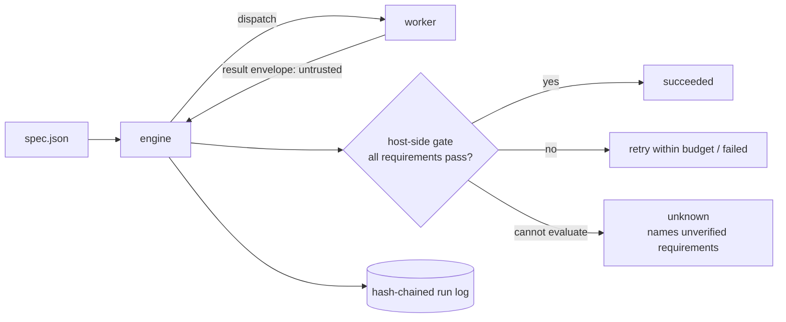

# warrant

**Evidence-gated execution of bounded AI work, with a reproducible fault-injection benchmark.**

When an AI worker (an agent, a script, a tool-using model) reports "done", most orchestrators believe it.
Under real failure conditions (crashes mid-effect, hung tools, malformed output, duplicate delivery,
cancellation) that is not evidence. `warrant` runs a DAG of tasks and only marks a task `succeeded` after the
**host** has checked its output against requirements the spec author wrote, records every state change in a
hash-chained log, and refuses to repeat an irreversible action on a guess.

It also ships the thing that lets you doubt all of that: a deterministic benchmark that compares the approach
against simpler orchestration policies on identical workloads and identical injected faults, and reports where
it loses.

> Status: a focused vertical slice, not a framework. Zero npm dependencies; Node 22+.
> Origin: derived in part from [Citadel](https://github.com/SethGammon/Citadel) (MIT). See
> [Attribution](#attribution-and-what-is-original).

## Quick start (no API key, no network)

```bash
node --version          # 22 or newer
npm run example         # 3-step pipeline of real subprocesses; every step passes the gate
npm run example:lying   # same pipeline, but `sort` exits 0 with unsorted output: the gate catches it
npm test                # 100+ tests incl. crash-at-every-log-boundary chaos test
npm run check           # syntax, hygiene, secret scan, vendored-file provenance
```

`npm run example:lying` exits non-zero and reports which requirements failed:

```
sort:      failed / GATE_FAILED   (requirements failed: exact, is-sorted)
summarize: blocked                (never executed)
```

Verify a log's hash chain and the protocol invariants after the fact:

```bash
node bin/warrant.js verify-log .warrant/run-pipeline/run.log --spec examples/pipeline/spec.json
```

## What it does

| Capability | Status |
|---|---|
| Typed run spec with validation (ids, cycles, limits, forbidden keys) | implemented |
| Task state machine; `succeeded` reachable only through a minted `GateVerdict` | implemented |
| Gate requirements: `artifact_sha256`, `artifact_json`, `command`, `predicate` (host-side) | implemented |
| Bounded concurrency, per-attempt deadlines, classified bounded retries with backoff | implemented |
| Per-attempt result deduplication; late and duplicate deliveries ignored | implemented |
| Effect classes with reconcile-before-retry for `external-nonrepeatable` tasks | implemented |
| Cancellation that aborts in-flight work and waits for workers to stop | implemented |
| Append-only hash-chained run log (fsync, torn-tail repair, single-writer lock) | implemented |
| `resume` from the log; independent `verify-log` invariant audit | implemented |
| Subprocess worker (no shell, scrubbed env, per-attempt dir, kill on deadline/cancel) | implemented |
| Deterministic simulated worker + seeded fault injection | implemented |
| Benchmark: 5 policies x 10 fault profiles x 5 workloads, bootstrap CIs, paired verdicts | implemented |
| Adapter for a specific agent runtime (Claude Code, Codex, ...) | **planned** (the `Worker` interface is the seam) |
| Signed log / receipts | planned |
| OS-level sandboxing of workers | planned (see [threat model](docs/THREAT_MODEL.md)) |
| Real-model evaluation | planned; the simulation says nothing about any real model |

## How a run works



The full module diagram, state machine, invariants (I1-I8) and recovery semantics are in
[docs/ARCHITECTURE.md](docs/ARCHITECTURE.md). The thesis and non-goals are in
[docs/PROJECT_THESIS.md](docs/PROJECT_THESIS.md); design decisions with evidence are in
[docs/DECISIONS.md](docs/DECISIONS.md).

A minimal task:

```json
{
  "id": "sort", "deps": ["fetch"], "effect": "pure",
  "deadline_ms": 10000, "max_attempts": 2, "outputs": ["out"],
  "exec": { "argv": ["node", "./scripts/sort.js"] },
  "requirements": [
    { "id": "exact",     "kind": "artifact_sha256", "artifact": "out", "sha256": "..." },
    { "id": "is-sorted", "kind": "command", "argv": ["node", "-e", "..."] }
  ]
}
```

A task with no requirements is rejected unless it says `"trust_worker": true`, and such a task is reported as
`CLAIM_ONLY`, never as verified. Full example: [examples/pipeline](examples/pipeline).

## Benchmark

```bash
npm run bench:dev      # development seeds 0..99, ~1 minute, writes results/dev
npm run bench:final    # held-out seeds 10000..10499, ~5 minutes, writes results/final
node bin/warrant.js report results/final     # regenerate REPORT.md and charts from summary.json
```

Methodology, frozen parameters, metric definitions and threats to validity:
[docs/EVALUATION_PROTOCOL.md](docs/EVALUATION_PROTOCOL.md). Results, with the cases where the gated approach
loses listed automatically: [results/final/REPORT.md](results/final/REPORT.md). All latencies there are
**simulated** milliseconds and all faults are injected by a seeded model.

## Layout

```
src/core      spec validation, states, scheduler, gate, verifiers
src/engine    engine (gated policy), envelope parsing, replay/audit/resume, baseline policies
src/log       hash-chained run log
src/workers   subprocess worker
src/sim       virtual clock, seeded fault plans, ground-truth world, fake worker
src/bench     workloads, metrics, stats, runner, aggregation, report
src/cli       command line
third_party/  verbatim upstream files (never edited; hashes checked by `npm run check`)
```

## Security and privacy

Worker output is untrusted data; only typed envelope fields are read and nothing a worker says can change policy.
Subprocesses run without a shell, with a scrubbed environment, in a per-attempt directory, and are killed on
deadline or cancel. Logs carry digests and short codes, not artifact bodies. **This is not a sandbox:** workers run
as your user. Run untrusted workers in a container or VM. Details and residual risks:
[docs/THREAT_MODEL.md](docs/THREAT_MODEL.md). No telemetry, no network access, no environment variables required.

## Known limitations

- The benchmark uses simulated workers and assumed fault rates. It shows how the policies behave under that
  fault model, not how any real model behaves.
- The gate is only as strong as the requirements you write. Missing requirements mean missing guarantees.
- After an orchestrator crash, worker processes it had started are not tracked; non-repeatable tasks that were in
  flight are resolved through `reconcile` or end `unknown`. The command worker has no `reconcile`, so those end `unknown`.
- Log lock reclamation relies on process liveness; pid reuse can make a stale lock look live (`breakLock` overrides).
- Verified on Windows 11 / Node 22.19. CI definitions for Linux and Windows are included but were not executed on
  GitHub hosted runners at the time of writing.

## Attribution and what is original

This repository starts from a small subset of [Citadel](https://github.com/SethGammon/Citadel) by Seth Gammon
(MIT, revision `16ab6ee`): the canonical-JSON digest helper, and the design of the effect-classed, hash-chained
journal and its recovery table. Those files are kept verbatim in `third_party/citadel/`; everything else is new
work in this repository. [UPSTREAM_PROVENANCE.md](UPSTREAM_PROVENANCE.md) lists exactly what was taken and what
changed. [AUDIT.md](AUDIT.md) documents the upstream defects found while doing so.

License: MIT. See [LICENSE](LICENSE) and [third_party/citadel/LICENSE](third_party/citadel/LICENSE).
