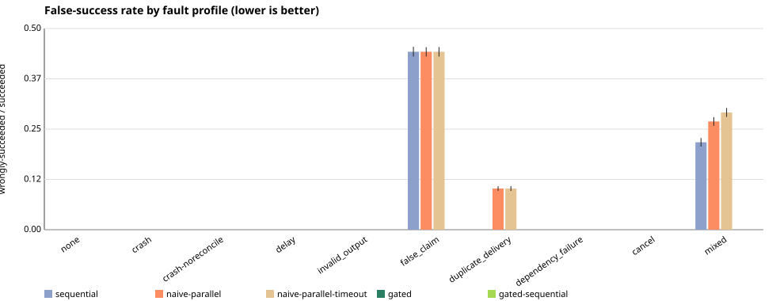
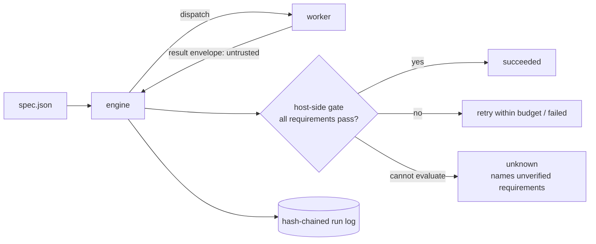

# warrant

[](https://github.com/Ujjwaljain16/Warrant/actions/workflows/ci.yml)


**Don't take an AI worker's word that it's done. Check it.**

`warrant` runs a DAG of tasks for AI workers (agents, scripts, tool-using models) and marks a task `succeeded` only
after the **host** has verified its output against requirements the spec author wrote. Every state change goes into a
hash-chained, crash-recoverable log, and an irreversible action is never repeated on a guess.

It also ships a deterministic fault-injection benchmark that compares this against simpler orchestration policies
on identical workloads and identical injected faults, and reports where it loses.

## Result

125,000 simulated runs, held-out seeds, 500 paired trials per cell. Closest baseline: same deadlines and retries, no gate.

| fault | metric | closest baseline | **warrant** |
|---|---|---|---|
| workers falsely claim success | false-success rate | 44.2% | **0%** |
| mixed faults | false-success rate | 29.1% | **0%** |
| mixed faults | duplicate non-repeatable effects | 19.0% | **0%** |
| duplicate delivery | false-success rate | 10.2% | **0%** |
| crash mid-effect | duplicate non-repeatable effects | 10.4% | **0%** |

The cost is real and measured: +49 ms simulated latency with no faults at all, and 13.5 points *fewer* tasks completed
when non-repeatable work cannot be reconciled, because warrant refuses to guess. Workers are simulated, so this says
nothing about any real model. Full tables, CIs and the cases it loses: [docs/BENCHMARK.md](docs/BENCHMARK.md) and
[results/final/REPORT.md](results/final/REPORT.md).



## Try it (no API key, no network, zero dependencies)

```bash
npm run example         # 3-step pipeline of real subprocesses; every step passes the gate
npm run example:lying   # same pipeline, but `sort` exits 0 with unsorted output: the gate catches it
npm test                # 100+ tests incl. a crash-at-every-log-boundary chaos test
npm run check           # syntax, hygiene, secret scan, vendored-file provenance
```

`npm run example:lying` exits non-zero and names the failed requirements:

```
sort:      failed / GATE_FAILED   (requirements failed: exact, is-sorted)
summarize: blocked                (never executed)
```

Audit a finished log's hash chain and protocol invariants independently of the engine:

```bash
node bin/warrant.js verify-log .warrant/run-pipeline/run.log --spec examples/pipeline/spec.json
```

## How it works



- **Evidence-gated:** `succeeded` is reachable only through a gate verdict minted by the host (digest, JSON, command
  and predicate checks). A task with no requirements is reported `CLAIM_ONLY`, never as verified.
- **Failure-safe:** per-attempt deadlines, bounded classified retries, deduplicated late and duplicate deliveries,
  cancellation that aborts in-flight work, and reconcile-before-retry for non-repeatable effects.
- **Recoverable and auditable:** append-only fsynced log with torn-tail repair, `resume` after a crash, and an
  independent `verify-log` check of invariants I1-I8.
- **Contained:** subprocess workers run with no shell, a scrubbed environment and a per-attempt directory, and are
  killed on deadline or cancel. This is not a sandbox; see the [threat model](docs/THREAT_MODEL.md).

## Docs

| | |
|---|---|
| [PROJECT_THESIS](docs/PROJECT_THESIS.md) | the problem, the claim, and the non-goals |
| [ARCHITECTURE](docs/ARCHITECTURE.md) | modules, state machine, invariants, recovery semantics |
| [DECISIONS](docs/DECISIONS.md) | design decisions, each with the evidence behind it |
| [EVALUATION_PROTOCOL](docs/EVALUATION_PROTOCOL.md) | benchmark methodology and threats to validity |
| [THREAT_MODEL](docs/THREAT_MODEL.md) | trust boundaries and residual risks |
| [OVERVIEW](docs/OVERVIEW.md) | capability status, task spec example, layout, known limitations |

## Status and roadmap

A focused vertical slice, not a framework. Node 22+.

- [x] Gate, engine, log, subprocess worker, CLI, benchmark harness
- [ ] Adapter for a real agent runtime (the `Worker` interface is the seam) and a real-model evaluation
- [ ] Signed log / receipts
- [ ] OS-level sandboxing of workers

## Attribution and what is original

About 3,300 lines of source and 1,900 lines of tests are original to this repository: the spec and gate, the engine,
the worker, the simulator, the benchmark and the CLI. A small subset of [Citadel](https://github.com/SethGammon/Citadel)
by Seth Gammon (MIT, revision `16ab6ee`) is vendored unmodified in `third_party/citadel/` (about 1,000 lines): the
canonical-JSON digest helper, and the effect-classed, hash-chained journal design that `src/log/runlog.js` was
rewritten from. [docs/UPSTREAM_PROVENANCE.md](docs/UPSTREAM_PROVENANCE.md) lists exactly what was taken and what
changed, and [docs/AUDIT.md](docs/AUDIT.md) documents the upstream defects found along the way.

License: MIT. See [LICENSE](LICENSE) and [third_party/citadel/LICENSE](third_party/citadel/LICENSE).
