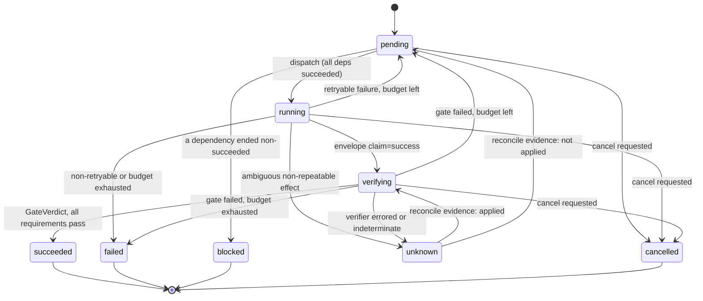

# Architecture

This document describes the design implemented in this repository. The status of each
module (implemented / experimental / planned) is tracked in [OVERVIEW.md](OVERVIEW.md).

```mermaid
flowchart LR
  spec[run spec JSON] --> V[core/spec<br/>validate + DAG check]
  V --> E[engine/engine<br/>gated policy]
  subgraph engine
    E --> S[core/scheduler<br/>O(degree) ready set]
    E --> ST[core/states<br/>transition table]
    E --> G[core/gate<br/>evaluateGate -> GateVerdict]
  end
  E <-->|dispatch / deliver| W{{Worker interface}}
  W --- FW[sim/fake-worker<br/>seeded faults]
  W --- CW[workers/command-worker<br/>subprocess]
  CW --- RW[workers/receipt-worker<br/>+ reconcile from receipts]
  G --> VK[core/verifiers<br/>sha256 / json / command / predicate]
  E --> L[log/runlog<br/>hash-chained events]
  L --- ML[MemoryRunLog]
  L --- FL[FileRunLog<br/>lease lock]
  L --> R[engine/replay<br/>resume + verify-log]
  B1[engine/baselines<br/>sequential, naive-parallel] <-->|same Worker| W
  BENCH[bench/runner] --> E
  BENCH --> B1
  BENCH --> SIM[sim/clock + faultplan + world<br/>ground-truth ledger]
  SIM --- FW
  BENCH --> RPT[bench/report<br/>raw JSONL, summary JSON, REPORT.md]
```

## Module responsibilities

| Module | Responsibility | Notes |
|---|---|---|
| `src/core/spec.js` | Validate run specs: id syntax, unknown deps, cycles, limits, requirement shapes. Returns a frozen, normalized spec. | Rejects `__proto__` / `constructor` keys. |
| `src/core/states.js` | Status set and transition table; `assertTransition`. | Terminal states absorb. |
| `src/core/gate.js` | `evaluateGate(task, artifacts, verifiers)` returns a frozen, branded `GateVerdict`; `isGateVerdict` checks the brand. | The only source of verdicts. |
| `src/core/verifiers.js` | Requirement kinds: `artifact_sha256`, `artifact_json`, `command`, `predicate`. | Host-side only; never sees worker claims. |
| `src/core/scheduler.js` | Dependency-aware ready set derived from task states; O(degree) per transition. | State-derived readiness, not counter-based. |
| `src/log/runlog.js` | Append-only, hash-chained event log (`MemoryRunLog`, `FileRunLog`) with a lease lock. | Derived from the vendored upstream journal. |
| `src/engine/engine.js` | Gated policy: bounded concurrency, deadlines, retry classification, idempotent ingestion, cancellation, effect-class recovery. | |
| `src/engine/replay.js` | Rebuild state from a log; `resume`; `verifyLog`. | |
| `src/engine/baselines.js` | `sequential` and `naive-parallel` comparison policies. | Intentionally simple. |
| `src/workers/command-worker.js` | Real path: spawn a command in an attempt directory with deadline, kill, output caps. | No `reconcile`. |
| `src/workers/receipt-worker.js`, `receipt.js` | `CommandWorker` plus `reconcile` for commands that follow the receipt protocol (`exec.receipt: true`). | See "Reconcile from receipts". |
| `src/sim/*` | Virtual clock, seeded fault plan, ground-truth world ledger, fake worker. | Used by tests and benchmarks. |
| `src/bench/*` | Workloads, metrics, statistics, runner, report writer. | |
| `bin/warrant.js` | CLI: `run`, `resume`, `verify-log`, `bench`, `report`. | |

## Worker contract

```
worker.execute(attempt, ctx) -> Promise<void>
  attempt: { runId, taskId, attemptNo, attemptId, idempotencyKey, inputs, task }
  ctx:     { signal: AbortSignal, deliver(envelope), clock }
  envelope: { attemptId, claim: 'success' | 'failure', retryable?: boolean,
              errorCode?: string, artifacts: { [name]: string } }
worker.reconcile?(attempt) -> Promise<{ applied: boolean, artifacts?: {...} }>
```

Results arrive through `ctx.deliver`, which a transport may call more than once
(at-least-once delivery). A rejected promise models a crash. A promise that never
settles models a hang. The engine, not the worker, decides what any of that means.

### Agent worker

`AgentWorker` (`src/agent/worker.js`) is a Worker whose attempt is a model-driven episode in `<attempt>/workspace`. The agent's
`finish` claim is mapped onto the envelope: `done` becomes `success` with the declared output files, and everything else becomes
`failure` with `AGENT_CANNOT`, `MAX_STEPS`, `PROTOCOL_ERROR`, `LLM_ERROR` or `QUOTA_EXHAUSTED`. The task's only requirement is a
`command` verifier running `scripts/agent-gate.js`, which judges the declared outputs of the agent's workspace with the `hidden/gate` tests in two
Docker containers (the code under test in one, the tests and the verdict in the other, joined by a host-relayed line protocol; see `docs/AGENT_BENCHMARK.md`). The claim is an input to
the gate and never a verdict. The experiment built on this (tasks, runner, analysis) is described in
[AGENT_BENCHMARK.md](AGENT_BENCHMARK.md) and its protocol in [AGENT_CLAIMS_PROTOCOL.md](AGENT_CLAIMS_PROTOCOL.md).

## Trust boundaries

1. **Worker output is untrusted data.** Envelopes are schema-checked; artifact names are validated
   (no path separators, no traversal, bounded size and count); a claim of success is only an input to the gate.
2. **Verification is host-side.** Requirements come from the spec author, not from the worker.
   Commands run from an argv array (no shell), with a scrubbed environment, a working directory
   confined to the attempt directory, a deadline, and output caps.
3. **Authority lives in the spec and the engine**, not in text a worker emits. No code path lets worker
   output edit a spec, widen a deadline or retry budget, or mark a task verified.

## State machine



`unknown` is terminal for a run unless a `reconcile` resolution is available.

## Invariants

Checked after the fact, independently of the engine, by `auditLog` in `src/engine/replay.js` (one implementation, `src/engine/audit-core.js`, shared with the MCP verify tool and the viewer; run on every gated benchmark trial and by `warrant verify-log --spec`), and exercised by `engine.test.js`, `resume.test.js`, `bench.test.js`, `viewer.test.js` and `mcp.test.js`. Besides I1-I8 it rejects logs that tell an impossible story: events for attempts that never started, a success whose claimed result and verdict name different digests, a `run_started` that is not first or carries another spec's digest, and a `run_finished` that is not last or disagrees with the settled tasks.

- **I1** `succeeded` implies a recorded gate verdict with every requirement passing, bound to the digest of that attempt's artifacts, and a claimed result (or an applied reconcile) with the same digest.
- **I2** A task is dispatched only when every dependency is `succeeded`.
- **I3** Attempts per task never exceed the budget; in-flight attempts never exceed the concurrency cap.
- **I4** Terminal states absorb: no transition leaves them (other than the `unknown` reconcile path).
- **I5** An `external-nonrepeatable` task has at most one effect-starting attempt unless a reconcile resolution proves the earlier effect did not apply.
- **I6** Each `(task, attempt)` result is ingested at most once; later deliveries are logged as duplicates and ignored.
- **I7** After cancellation is requested, no new attempt starts.
- **I8** The log hash chain verifies, and `replay(log)` reproduces the live final state.

## Recovery semantics

On resume, tasks the log shows as `running` or `verifying` with no terminal event are classified by effect class using
the decision table inherited from upstream `recovery.js`: `pure` and `workspace-reversible` re-run;
`external-idempotent` re-runs with the same idempotency key; `external-nonrepeatable` becomes `unknown` unless the
worker's `reconcile` returns evidence, in which case the log records the resolution before any further action.
A corrupt log blocks resume (fail closed).

## Reconcile from receipts (`ReceiptWorker`)

A non-repeatable task whose worker dies after the effect is `unknown` unless the worker can answer "was it applied?" from
evidence. `ReceiptWorker` extends `CommandWorker` for commands that opt in with `"exec": { "argv": [...], "receipt": true }`
(any other task runs exactly as under `CommandWorker`). The host and the command leave files in the per-attempt directory:

| File | Written by | When | Meaning |
|---|---|---|---|
| `<attempt>.host.json` (next to the attempt directory, not inside it) | host | before the process starts; again with the pid; again with the exit code | this attempt got as far as starting; which process; how it ended |
| `effect.intent` | command | just before the external effect | the effect may have begun |
| `receipt.json` | command | last, atomically, after the effect and all declared outputs | `{version, idempotency_key, outputs: {name: sha256}}` |

`reconcile` reads only those files and the process table:

- valid receipt whose key matches and whose output digests match the files on disk: **applied**, returning the artifacts.
  The engine still sends them through the gate, so a receipt is evidence of the effect, not a pass.
- no receipt, the recorded pid is gone, the command did not exit 0, and `effect.intent` does not exist: **not applied**
  (the engine may run the task again, with the same idempotency key).
- anything else (no attempt record, pid unknown or still alive, intent without receipt, exit 0 without receipt, a receipt that
  is unreadable, for another key, or disagrees with the outputs): reconcile throws, the log records `inconclusive`, and the
  task ends `unknown`. Nothing is repeated on a guess.

Limits: "not applied" is only as true as the command's promise to write `effect.intent` before the effect (a command that
breaks it can be repeated). Liveness is `kill(pid, 0)`; pid reuse errs toward `unknown`, but descendants that outlive
their parent are not tracked. Writes are atomic against a process crash (temp file, fsync, rename), not against power loss.
The receipt is not authenticated: a command can write a false one. It is not a sandbox. Tested with real subprocesses
through the real engine in `test/receipt-worker.test.js`; runnable example in `examples/receipt`.

## Configuration authority

The run spec is the single source of execution policy (deadlines, retry budgets, requirements, effect classes).
CLI flags may only lower concurrency below the spec's cap. Environment variables never change policy.
