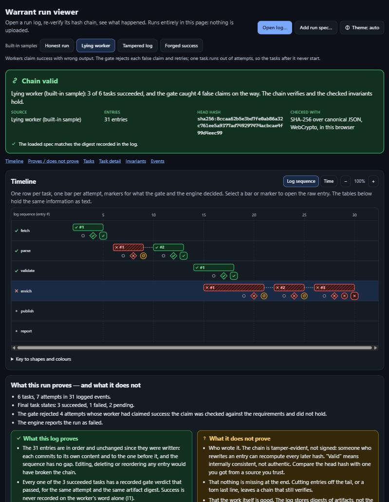

# Run viewer

`viewer/run-viewer.html` is a single static file that opens a warrant run log (the JSONL written by
`src/log/runlog.js`) and shows what happened: a per-task timeline, the state transitions, every event, and an
independent re-check of the hash chain and the invariants. It needs no server, no network and no install: open
the file in a browser, or drop a log on it.



## Using it

```bash
node scripts/build-viewer.js        # regenerates viewer/run-viewer.html from viewer/src/
```

Open `viewer/run-viewer.html`, then either pick one of the four built-in samples or load your own log
(**Open log…** or drag and drop). Drop the run's spec JSON together with the log, or add it with **Add run spec…**,
to check the invariants that need the spec (I2, I3, I5). A spec is recognised by content, so file names do not matter.

| Sample | What it shows |
|---|---|
| Honest run | Six tasks; one crash retried, one ambiguous one-shot effect reconciled, one duplicate delivery ignored. |
| Lying worker | Workers claim success with wrong output. The gate rejects four claims; one task runs out of attempts and its dependents never start. |
| Tampered log | The lying-worker log with one verdict edited from fail to pass. The chain breaks at entry 8 and the page says why. |
| Forged success | A failed task rewritten as succeeded with every hash recomputed. The chain still verifies; the audit reports I1. |

The samples are real engine output (virtual clock, scripted faults), regenerated with
`node scripts/gen-viewer-samples.js` (`--check` compares against the stored files).

## What it checks

* **Hash chain**, in the browser: SHA-256 over the canonical JSON (sorted keys) of each entry, identical to
  `third_party/citadel/core/operations/canonical.js`, linked by `prev`, with the engine's structural rules and error
  messages. WebCrypto is used; if the page is opened where `crypto.subtle` does not exist (an insecure context,
  for example a `data:` URL), a built-in SHA-256 takes over and the banner says so. The badge reads *chain valid*,
  *chain valid · torn final line tolerated* (the engine's rule: an unfinished last line is ignored), or
  *chain broken at entry N* with the reason, the stored and the recomputed hash, and everything from N onward drawn
  hatched as unverified.
* **Invariants**: the viewer runs the engine's own audit, `src/engine/audit-core.js` (`scripts/build-viewer.js` copies that file into the page;
  it is not a port, so the two cannot drift). From the log alone: I1 (success needs a claimed result and a passing verdict about the
  same digest), I4 (terminal states are final), I6 (each result ingested once), I7 (nothing starts after cancel), I8 (chain), attempt numbering,
  *events belong to started attempts* (a result, verdict or settlement for an attempt that never started is a violation) and *run start and finish
  are consistent* (one `run_started`, more only when resumed; `run_finished` last, with the status and counts the settled tasks imply);
  I2 (dependencies), I3 (attempt budget, concurrency cap), I5 (non-repeatable effects), unknown tasks, the spec digest and
  the blocked tasks of `run_finished` once the spec is loaded. Without the spec these rows read *Needs spec*, never *Holds*.
  With the spec the answers are identical to `auditLog`; `test/viewer.test.js` compares them on logs the real engine
  wrote, on mutated copies of them, and on twelve forged logs whose hashes were recomputed. On a broken chain the engine's audit stops at I8; the viewer reports that
  and evaluates the rest on the verified prefix only, labelled as such.
* **Spec digest**: if a spec is loaded, its canonical digest is compared with the one in `run_started`.

## What it does not prove

The page states this next to every verdict (*What this run proves — and what it does not*). In short: a valid chain
means the entries are consistent and unaltered, not that they are authentic (anyone can rewrite an entry and recompute
the hashes — see the *Forged success* sample), not that nothing was cut off the end, and not that the work was good
(the log holds artifact digests, not artifacts, and a verdict is only as strong as its requirements).

## Treating logs as untrusted

A log can come from anywhere, so the page is built to be inert against hostile content:

* All DOM is built with `createElement` and `textContent` (`viewer/src/dom.js` has no HTML-string path and refuses
  `on*` and `style` attributes). Nothing uses `innerHTML`, `eval` or inline handlers; a test fails the build if the
  output contains any.
* A restrictive `Content-Security-Policy` meta tag: `default-src 'none'`, script and style allowed only by the SHA-256
  of the inline code (computed by the build), no `connect-src`, `base-uri` and `form-action` `'none'`. The page cannot
  make a network request even if something went wrong. No web fonts, CDN or analytics.
* Bidi overrides, zero-width and control characters are shown as visible `<U+202E>` markers; long strings are clipped
  and wrapped; table cells and the raw-entry view cannot widen the page.
* Limits: 20 MB per file, 100,000 entries, 1,000,000 characters per line, with a clear message when exceeded.
  Malformed lines are reported, not fatal.

## Layout of the code

```
viewer/src/            canonical.js  states.js  text.js  parse.js  chain.js  audit-core.js  audit.js  model.js  describe.js
                       summary.js  analysis.js        pure logic, loadable in Node (these are what the tests run)
                       dom.js  icons.js  timeline.js  views.js  app.js     browser-only UI
                       index.template.html  style.css
viewer/samples/        generated sample logs and their run spec
viewer/screenshots/    images for the README
scripts/build-viewer.js          bundles everything into viewer/run-viewer.html (deterministic)
scripts/gen-viewer-samples.js    regenerates viewer/samples/ from the real engine
test/viewer.test.js              Node-only, offline
```

`viewer/run-viewer.html` is generated; edit `viewer/src/` and rebuild. The build is byte-for-byte reproducible and a
test fails if the stored file is stale.

## Tests

```bash
node --test test/viewer.test.js
```

Chain verification, audit and replay results are compared with `verifyEntries`, `readRunLogFile`, `auditLog` and
`replayLog` on engine-written logs: honest, false claim, retry exhaustion, crash with reconcile (applied and not
applied), no reconcile, duplicate delivery, deadline, cancel; and on torn tails, a corrupt middle line, a tampered
entry, a forged (re-hashed) success and 160 deterministically damaged logs. The built file is checked for external
references, markup-injection APIs, and for a CSP whose hashes match its inline script and style.

Not covered by tests: rendering. That was checked by hand in a Chromium-based browser (both colour schemes, a
360 px viewport with no sideways page scroll, a hostile log, the accessibility tree and keyboard activation of
timeline items by synthetic key events, not a real keyboard session); Firefox and Safari have not been tried.
