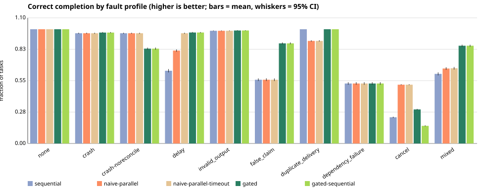
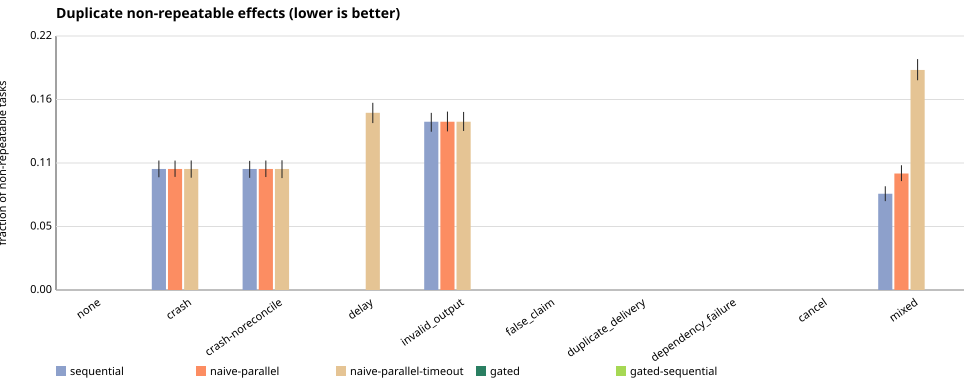

# Benchmark report: final seeds

> **Simulated workers.** All latencies below are *simulated milliseconds* on a virtual clock and all faults are injected by a seeded model. These results say how the orchestration policies behave under the stated fault model; they are not measurements of any real model or provider.

## Provenance

| field | value |
| --- | --- |
| git commit | `404dc01fe221b4295091ddff93a3202bdc656a52` |
| protocol / dataset | v1 / `workloads-v1` |
| seeds | final: 10000..10499 (500 trials per cell) |
| cells | 5 workloads x 10 profiles x 5 policies |
| total runs | 125000 |
| model / provider | none (deterministic simulation) |
| parameters | protocol_version=1, retry_budget=3, gated_deadline_multiple=3, gated_backoff_ms_per_attempt=20, gate_cost_ms_per_requirement=5, tokens_per_worker_ms=10, run_cap_multiple_of_critical_path=30, concurrency_cap=4 |
| environment | node v22.19.0, win32/x64 |
| command | `node bin/warrant.js bench --seeds final --out results/final` |
| wall-clock to produce | 146.9 s (real time; unrelated to simulated ms) |

Raw per-run results: `raw.jsonl.gz`. Aggregates: `summary.json`. Regenerate this file with `node bin/warrant.js report <this directory>`.

## Self-checks

- Log audit of every gated run (invariants I1-I8 checked independently of the engine): **0 violations in 50000 audited runs**.
- Runs in which a policy exceeded its concurrency cap: sequential 0, naive-parallel 0, naive-parallel-timeout 0, gated 0, gated-sequential 0.
- Runs ended by the run-level cap (a hung attempt never resolved): sequential 2281, naive-parallel 2281, naive-parallel-timeout 0, gated 0, gated-sequential 0.

## Headline results (pooled over all workloads)

**Reading the `cancel` profile:** work completed after a cancel request counts toward `correct completion`, so a policy that honours cancellation scores lower there by design. Judge that profile by `effects after cancel/run` (lower is better).

Means with 95% bootstrap CIs over trials. `n/a` = not measurable (e.g. no task succeeded, so a false-success *rate* is undefined); it is never shown as 0.

| profile | policy | correct completion | false-success rate | duplicate-effect rate | dep-order violations/run | effects after cancel/run | makespan P50 / P95 (sim ms) | tokens per correct task | attempts/run |
| --- | --- | --- | --- | --- | --- | --- | --- | --- | --- |
| none | sequential | 1.000 [1.000, 1.000] | 0.000 [0.000, 0.000] | 0.000 [0.000, 0.000] (n=2000/2500) | 0.000 | n/a | 1684 / 3304 | 1026 [1025, 1026] | 18.4 |
| none | naive-parallel | 1.000 [1.000, 1.000] | 0.000 [0.000, 0.000] | 0.000 [0.000, 0.000] (n=2000/2500) | 0.000 | n/a | 643 / 919 | 1026 [1025, 1026] | 18.4 |
| none | naive-parallel-timeout | 1.000 [1.000, 1.000] | 0.000 [0.000, 0.000] | 0.000 [0.000, 0.000] (n=2000/2500) | 0.000 | n/a | 643 / 919 | 1026 [1025, 1026] | 18.4 |
| none | gated | 1.000 [1.000, 1.000] | 0.000 [0.000, 0.000] | 0.000 [0.000, 0.000] (n=2000/2500) | 0.000 | n/a | 703 / 974 | 1026 [1025, 1026] | 18.4 |
| none | gated-sequential | 1.000 [1.000, 1.000] | 0.000 [0.000, 0.000] | 0.000 [0.000, 0.000] (n=2000/2500) | 0.000 | n/a | 1809 / 3549 | 1026 [1025, 1026] | 18.4 |
| crash | sequential | 0.965 [0.960, 0.969] | 0.000 [0.000, 0.000] (n=2492/2500) | 0.104 [0.097, 0.112] (n=2000/2500) | 0.000 | n/a | 1864 / 3825 | 1183 [1178, 1189] (n=2492/2500) | 22.3 |
| crash | naive-parallel | 0.965 [0.960, 0.970] | 0.000 [0.000, 0.000] (n=2492/2500) | 0.104 [0.098, 0.112] (n=2000/2500) | 0.000 | n/a | 770 / 1093 | 1183 [1178, 1189] (n=2492/2500) | 22.3 |
| crash | naive-parallel-timeout | 0.965 [0.960, 0.970] | 0.000 [0.000, 0.000] (n=2492/2500) | 0.104 [0.097, 0.112] (n=2000/2500) | 0.000 | n/a | 770 / 1093 | 1183 [1178, 1189] (n=2492/2500) | 22.3 |
| crash | gated | 0.971 [0.966, 0.975] | 0.000 [0.000, 0.000] (n=2492/2500) | 0.000 [0.000, 0.000] (n=2000/2500) | 0.000 | n/a | 847 / 1167 | 1159 [1154, 1164] (n=2492/2500) | 21.9 |
| crash | gated-sequential | 0.971 [0.966, 0.975] | 0.000 [0.000, 0.000] (n=2492/2500) | 0.000 [0.000, 0.000] (n=2000/2500) | 0.000 | n/a | 1974 / 3942 | 1159 [1154, 1164] (n=2492/2500) | 21.9 |
| crash-noreconcile | sequential | 0.965 [0.960, 0.969] | 0.000 [0.000, 0.000] (n=2492/2500) | 0.104 [0.097, 0.111] (n=2000/2500) | 0.000 | n/a | 1864 / 3825 | 1183 [1178, 1189] (n=2492/2500) | 22.3 |
| crash-noreconcile | naive-parallel | 0.965 [0.960, 0.970] | 0.000 [0.000, 0.000] (n=2492/2500) | 0.104 [0.097, 0.112] (n=2000/2500) | 0.000 | n/a | 770 / 1093 | 1183 [1178, 1189] (n=2492/2500) | 22.3 |
| crash-noreconcile | naive-parallel-timeout | 0.965 [0.960, 0.969] | 0.000 [0.000, 0.000] (n=2492/2500) | 0.104 [0.097, 0.112] (n=2000/2500) | 0.000 | n/a | 770 / 1093 | 1183 [1178, 1189] (n=2492/2500) | 22.3 |
| crash-noreconcile | gated | 0.830 [0.821, 0.839] | 0.000 [0.000, 0.000] (n=2492/2500) | 0.000 [0.000, 0.000] (n=2000/2500) | 0.000 | n/a | 771 / 1095 | 1201 [1194, 1208] (n=2492/2500) | 18.1 |
| crash-noreconcile | gated-sequential | 0.830 [0.820, 0.840] | 0.000 [0.000, 0.000] (n=2492/2500) | 0.000 [0.000, 0.000] (n=2000/2500) | 0.000 | n/a | 1552 / 3432 | 1201 [1194, 1208] (n=2492/2500) | 18.1 |
| delay | sequential | 0.637 [0.622, 0.651] | 0.000 [0.000, 0.000] (n=2353/2500) | 0.000 [0.000, 0.000] (n=2000/2500) | 0.000 | n/a | 9870 / 23760 (1441 capped) | 24439 [22765, 26044] (n=2353/2500) | 11.3 |
| delay | naive-parallel | 0.813 [0.803, 0.823] | 0.000 [0.000, 0.000] (n=2440/2500) | 0.000 [0.000, 0.000] (n=2000/2500) | 0.000 | n/a | 9870 / 23760 (1441 capped) | 16299 [15144, 17579] (n=2440/2500) | 15.7 |
| delay | naive-parallel-timeout | 0.965 [0.960, 0.970] | 0.000 [0.000, 0.000] (n=2492/2500) | 0.153 [0.144, 0.161] (n=2000/2500) | 0.000 | n/a | 1339 / 2109 | 1852 [1827, 1880] (n=2492/2500) | 22.3 |
| delay | gated | 0.971 [0.967, 0.976] | 0.000 [0.000, 0.000] (n=2492/2500) | 0.000 [0.000, 0.000] (n=2000/2500) | 0.000 | n/a | 1404 / 2165 | 1795 [1771, 1821] (n=2492/2500) | 21.7 |
| delay | gated-sequential | 0.971 [0.967, 0.975] | 0.000 [0.000, 0.000] (n=2492/2500) | 0.000 [0.000, 0.000] (n=2000/2500) | 0.000 | n/a | 2989 / 6193 | 1795 [1771, 1821] (n=2492/2500) | 21.7 |
| invalid_output | sequential | 0.986 [0.983, 0.989] | 0.000 [0.000, 0.000] (n=2498/2500) | 0.145 [0.137, 0.153] (n=2000/2500) | 0.000 | n/a | 1922 / 4031 | 1217 [1210, 1223] (n=2498/2500) | 21.4 |
| invalid_output | naive-parallel | 0.986 [0.984, 0.989] | 0.000 [0.000, 0.000] (n=2498/2500) | 0.145 [0.137, 0.154] (n=2000/2500) | 0.000 | n/a | 800 / 1178 | 1217 [1211, 1223] (n=2498/2500) | 21.4 |
| invalid_output | naive-parallel-timeout | 0.986 [0.984, 0.989] | 0.000 [0.000, 0.000] (n=2498/2500) | 0.145 [0.137, 0.154] (n=2000/2500) | 0.000 | n/a | 800 / 1178 | 1217 [1211, 1223] (n=2498/2500) | 21.4 |
| invalid_output | gated | 0.989 [0.986, 0.991] | 0.000 [0.000, 0.000] (n=2498/2500) | 0.000 [0.000, 0.000] (n=2000/2500) | 0.000 | n/a | 859 / 1218 | 1184 [1178, 1190] (n=2498/2500) | 20.8 |
| invalid_output | gated-sequential | 0.989 [0.986, 0.991] | 0.000 [0.000, 0.000] (n=2498/2500) | 0.000 [0.000, 0.000] (n=2000/2500) | 0.000 | n/a | 2031 / 4081 | 1184 [1178, 1190] (n=2498/2500) | 20.8 |
| false_claim | sequential | 0.558 [0.547, 0.570] | 0.442 [0.430, 0.454] | 0.000 [0.000, 0.000] (n=2000/2500) | 0.000 | n/a | 1684 / 3304 | 2729 [2595, 2873] (n=2347/2500) | 18.4 |
| false_claim | naive-parallel | 0.558 [0.547, 0.570] | 0.442 [0.430, 0.453] | 0.000 [0.000, 0.000] (n=2000/2500) | 0.000 | n/a | 643 / 919 | 2729 [2600, 2871] (n=2347/2500) | 18.4 |
| false_claim | naive-parallel-timeout | 0.558 [0.546, 0.570] | 0.442 [0.430, 0.454] | 0.000 [0.000, 0.000] (n=2000/2500) | 0.000 | n/a | 643 / 919 | 2729 [2596, 2873] (n=2347/2500) | 18.4 |
| false_claim | gated | 0.876 [0.868, 0.885] | 0.000 [0.000, 0.000] (n=2498/2500) | 0.000 [0.000, 0.000] (n=2000/2500) | 0.000 | n/a | 843 / 1185 | 1235 [1227, 1243] (n=2498/2500) | 18.2 |
| false_claim | gated-sequential | 0.876 [0.869, 0.885] | 0.000 [0.000, 0.000] (n=2498/2500) | 0.000 [0.000, 0.000] (n=2000/2500) | 0.000 | n/a | 1809 / 3771 | 1235 [1228, 1244] (n=2498/2500) | 18.2 |
| duplicate_delivery | sequential | 1.000 [1.000, 1.000] | 0.000 [0.000, 0.000] | 0.000 [0.000, 0.000] (n=2000/2500) | 0.000 | n/a | 1684 / 3304 | 1026 [1025, 1026] | 18.4 |
| duplicate_delivery | naive-parallel | 0.898 [0.892, 0.904] | 0.102 [0.096, 0.108] | 0.000 [0.000, 0.000] (n=2000/2500) | 1.219 | n/a | 643 / 792 | 1201 [1187, 1215] | 18.4 |
| duplicate_delivery | naive-parallel-timeout | 0.898 [0.892, 0.904] | 0.102 [0.096, 0.108] | 0.000 [0.000, 0.000] (n=2000/2500) | 1.219 | n/a | 643 / 792 | 1201 [1187, 1216] | 18.4 |
| duplicate_delivery | gated | 1.000 [1.000, 1.000] | 0.000 [0.000, 0.000] | 0.000 [0.000, 0.000] (n=2000/2500) | 0.000 | n/a | 703 / 974 | 1026 [1025, 1026] | 18.4 |
| duplicate_delivery | gated-sequential | 1.000 [1.000, 1.000] | 0.000 [0.000, 0.000] | 0.000 [0.000, 0.000] (n=2000/2500) | 0.000 | n/a | 1809 / 3549 | 1026 [1025, 1026] | 18.4 |
| dependency_failure | sequential | 0.525 [0.514, 0.536] | 0.000 [0.000, 0.000] | 0.000 [0.000, 0.000] (n=2000/2500) | 0.000 | n/a | 1103 / 2060 | 1270 [1258, 1281] | 12.6 |
| dependency_failure | naive-parallel | 0.525 [0.514, 0.537] | 0.000 [0.000, 0.000] | 0.000 [0.000, 0.000] (n=2000/2500) | 0.000 | n/a | 403 / 643 | 1270 [1258, 1282] | 12.6 |
| dependency_failure | naive-parallel-timeout | 0.525 [0.514, 0.537] | 0.000 [0.000, 0.000] | 0.000 [0.000, 0.000] (n=2000/2500) | 0.000 | n/a | 403 / 643 | 1270 [1258, 1282] | 12.6 |
| dependency_failure | gated | 0.525 [0.513, 0.537] | 0.000 [0.000, 0.000] | 0.000 [0.000, 0.000] (n=2000/2500) | 0.000 | n/a | 457 / 703 | 1270 [1259, 1283] | 12.6 |
| dependency_failure | gated-sequential | 0.525 [0.514, 0.537] | 0.000 [0.000, 0.000] | 0.000 [0.000, 0.000] (n=2000/2500) | 0.000 | n/a | 1183 / 2240 | 1270 [1258, 1282] | 12.6 |
| cancel | sequential | 0.229 [0.223, 0.234] | 0.000 [0.000, 0.000] | 0.000 [0.000, 0.000] (n=2000/2500) | 0.000 | 0.60 | 382 / 403 | 1002 [1001, 1003] | 3.4 |
| cancel | naive-parallel | 0.515 [0.511, 0.518] | 0.000 [0.000, 0.000] | 0.000 [0.000, 0.000] (n=2000/2500) | 0.000 | 1.40 | 401 / 423 | 1029 [1029, 1030] | 9.4 |
| cancel | naive-parallel-timeout | 0.515 [0.511, 0.518] | 0.000 [0.000, 0.000] | 0.000 [0.000, 0.000] (n=2000/2500) | 0.000 | 1.40 | 401 / 423 | 1029 [1029, 1030] | 9.4 |
| cancel | gated | 0.298 [0.293, 0.303] | 0.000 [0.000, 0.000] | 0.000 [0.000, 0.000] (n=2000/2500) | 0.000 | 0.00 | 317 / 396 | 1681 [1650, 1710] | 8.6 |
| cancel | gated-sequential | 0.154 [0.150, 0.159] | 0.000 [0.000, 0.000] | 0.000 [0.000, 0.000] (n=2000/2500) | 0.000 | 0.00 | 317 / 396 | 1282 [1273, 1290] | 3.2 |
| mixed | sequential | 0.609 [0.596, 0.622] | 0.217 [0.207, 0.228] (n=2429/2500) | 0.083 [0.077, 0.090] (n=2000/2500) | 0.000 | n/a | 3870 / 19290 (840 capped) | 14238 [13117, 15495] (n=2358/2500) | 17.2 |
| mixed | naive-parallel | 0.656 [0.645, 0.667] | 0.269 [0.258, 0.280] (n=2468/2500) | 0.101 [0.094, 0.108] (n=2000/2500) | 0.757 | n/a | 1525 / 19290 (840 capped) | 11257 [10410, 12204] (n=2398/2500) | 20.4 |
| mixed | naive-parallel-timeout | 0.658 [0.647, 0.670] | 0.291 [0.280, 0.302] (n=2480/2500) | 0.190 [0.181, 0.199] (n=2000/2500) | 0.776 | n/a | 1066 / 1685 | 2971 [2852, 3099] (n=2398/2500) | 23.4 |
| mixed | gated | 0.856 [0.846, 0.865] | 0.000 [0.000, 0.000] (n=2463/2500) | 0.000 [0.000, 0.000] (n=2000/2500) | 0.000 | n/a | 1188 / 1861 | 1775 [1750, 1802] (n=2463/2500) | 22.0 |
| mixed | gated-sequential | 0.856 [0.847, 0.864] | 0.000 [0.000, 0.000] (n=2463/2500) | 0.000 [0.000, 0.000] (n=2000/2500) | 0.000 | n/a | 2473 / 5391 | 1775 [1751, 1804] (n=2463/2500) | 22.0 |

## Paired comparisons (pooled)

Per-seed difference (first policy minus second) on identical fault plans; the verdict is "better" or "worse" only when the 95% CI of the mean difference excludes 0, otherwise "inconclusive". Direction is applied per metric (for example, lower false-success rate is better).

### gated vs sequential

| profile | correct_completion | false_success_rate | unsafe_final_status | duplicate_effect_rate | dependency_order_violations | effects_after_cancel | recovery_rate | makespan_ms | tokens_per_correct | attempts |
| --- | --- | --- | --- | --- | --- | --- | --- | --- | --- | --- |
| none | inconclusive (0.000) | inconclusive (0.000) | n/a | inconclusive (0.000) | inconclusive (0.000) | n/a | n/a | better (-1179) | inconclusive (0.000) | inconclusive (0.000) |
| crash | better (+0.006) | inconclusive (0.000) | inconclusive (0.000) | better (-0.104) | inconclusive (0.000) | n/a | better (+0.009) | better (-1254) | better (-24.798) | better (-0.397) |
| crash-noreconcile | worse (-0.135) | inconclusive (0.000) | inconclusive (0.000) | better (-0.104) | inconclusive (0.000) | n/a | worse (-0.198) | better (-1339) | worse (+17.365) | better (-4.221) |
| delay | better (+0.335) | inconclusive (0.000) | inconclusive (0.000) | inconclusive (0.000) | inconclusive (0.000) | n/a | n/a | better (-9762) | better (-22696) | worse (+10.387) |
| invalid_output | better (+0.003) | inconclusive (0.000) | inconclusive (0.000) | better (-0.145) | inconclusive (0.000) | n/a | n/a | better (-1333) | better (-32.483) | better (-0.654) |
| false_claim | better (+0.318) | better (-0.441) | better (-1.000) | inconclusive (0.000) | inconclusive (0.000) | n/a | n/a | better (-1071) | better (-1500) | inconclusive (-0.216) |
| duplicate_delivery | inconclusive (0.000) | inconclusive (0.000) | n/a | inconclusive (0.000) | inconclusive (0.000) | n/a | n/a | better (-1179) | inconclusive (0.000) | inconclusive (0.000) |
| dependency_failure | inconclusive (0.000) | inconclusive (0.000) | inconclusive (0.000) | inconclusive (0.000) | inconclusive (0.000) | n/a | n/a | better (-616) | inconclusive (0.000) | inconclusive (0.000) |
| cancel | better (+0.069) | inconclusive (0.000) | inconclusive (0.000) | inconclusive (0.000) | inconclusive (0.000) | better (-0.600) | n/a | better (-52.200) | worse (+679) | worse (+5.200) |
| mixed | better (+0.246) | better (-0.214) | better (-0.563) | better (-0.083) | inconclusive (0.000) | n/a | better (+0.117) | better (-6392) | better (-12525) | worse (+4.773) |

### gated vs naive-parallel

| profile | correct_completion | false_success_rate | unsafe_final_status | duplicate_effect_rate | dependency_order_violations | effects_after_cancel | recovery_rate | makespan_ms | tokens_per_correct | attempts |
| --- | --- | --- | --- | --- | --- | --- | --- | --- | --- | --- |
| none | inconclusive (0.000) | inconclusive (0.000) | n/a | inconclusive (0.000) | inconclusive (0.000) | n/a | n/a | worse (+49.000) | inconclusive (0.000) | inconclusive (0.000) |
| crash | better (+0.006) | inconclusive (0.000) | inconclusive (0.000) | better (-0.104) | inconclusive (0.000) | n/a | better (+0.009) | worse (+72.837) | better (-24.798) | better (-0.397) |
| crash-noreconcile | worse (-0.135) | inconclusive (0.000) | inconclusive (0.000) | better (-0.104) | inconclusive (0.000) | n/a | worse (-0.198) | better (-12.241) | worse (+17.365) | better (-4.221) |
| delay | better (+0.158) | inconclusive (0.000) | inconclusive (0.000) | inconclusive (0.000) | inconclusive (0.000) | n/a | n/a | better (-9194) | better (-14534) | worse (+5.915) |
| invalid_output | better (+0.003) | inconclusive (0.000) | inconclusive (0.000) | better (-0.145) | inconclusive (0.000) | n/a | n/a | worse (+53.852) | better (-32.483) | better (-0.654) |
| false_claim | better (+0.318) | better (-0.441) | better (-1.000) | inconclusive (0.000) | inconclusive (0.000) | n/a | n/a | worse (+157) | better (-1500) | inconclusive (-0.216) |
| duplicate_delivery | better (+0.102) | better (-0.102) | n/a | inconclusive (0.000) | better (-1.219) | n/a | n/a | worse (+107) | better (-175) | inconclusive (0.000) |
| dependency_failure | inconclusive (0.000) | inconclusive (0.000) | inconclusive (0.000) | inconclusive (0.000) | inconclusive (0.000) | n/a | n/a | worse (+48.800) | inconclusive (0.000) | inconclusive (0.000) |
| cancel | worse (-0.217) | inconclusive (0.000) | inconclusive (0.000) | inconclusive (0.000) | inconclusive (0.000) | better (-1.400) | n/a | better (-67.600) | worse (+652) | better (-0.800) |
| mixed | better (+0.200) | better (-0.267) | better (-0.716) | better (-0.101) | better (-0.757) | n/a | better (+0.147) | better (-5362) | better (-9546) | worse (+1.568) |

### gated vs naive-parallel-timeout

| profile | correct_completion | false_success_rate | unsafe_final_status | duplicate_effect_rate | dependency_order_violations | effects_after_cancel | recovery_rate | makespan_ms | tokens_per_correct | attempts |
| --- | --- | --- | --- | --- | --- | --- | --- | --- | --- | --- |
| none | inconclusive (0.000) | inconclusive (0.000) | n/a | inconclusive (0.000) | inconclusive (0.000) | n/a | n/a | worse (+49.000) | inconclusive (0.000) | inconclusive (0.000) |
| crash | better (+0.006) | inconclusive (0.000) | inconclusive (0.000) | better (-0.104) | inconclusive (0.000) | n/a | better (+0.009) | worse (+72.837) | better (-24.798) | better (-0.397) |
| crash-noreconcile | worse (-0.135) | inconclusive (0.000) | inconclusive (0.000) | better (-0.104) | inconclusive (0.000) | n/a | worse (-0.198) | better (-12.241) | worse (+17.365) | better (-4.221) |
| delay | better (+0.006) | inconclusive (0.000) | inconclusive (0.000) | better (-0.153) | inconclusive (0.000) | n/a | n/a | worse (+50.656) | better (-57.436) | better (-0.628) |
| invalid_output | better (+0.003) | inconclusive (0.000) | inconclusive (0.000) | better (-0.145) | inconclusive (0.000) | n/a | n/a | worse (+53.852) | better (-32.483) | better (-0.654) |
| false_claim | better (+0.318) | better (-0.441) | better (-1.000) | inconclusive (0.000) | inconclusive (0.000) | n/a | n/a | worse (+157) | better (-1500) | inconclusive (-0.216) |
| duplicate_delivery | better (+0.102) | better (-0.102) | n/a | inconclusive (0.000) | better (-1.219) | n/a | n/a | worse (+107) | better (-175) | inconclusive (0.000) |
| dependency_failure | inconclusive (0.000) | inconclusive (0.000) | inconclusive (0.000) | inconclusive (0.000) | inconclusive (0.000) | n/a | n/a | worse (+48.800) | inconclusive (0.000) | inconclusive (0.000) |
| cancel | worse (-0.217) | inconclusive (0.000) | inconclusive (0.000) | inconclusive (0.000) | inconclusive (0.000) | better (-1.400) | n/a | better (-67.600) | worse (+652) | better (-0.800) |
| mixed | better (+0.197) | better (-0.286) | better (-0.715) | better (-0.190) | better (-0.776) | n/a | better (+0.205) | worse (+117) | better (-1206) | better (-1.486) |

### gated-sequential vs sequential

| profile | correct_completion | false_success_rate | unsafe_final_status | duplicate_effect_rate | dependency_order_violations | effects_after_cancel | recovery_rate | makespan_ms | tokens_per_correct | attempts |
| --- | --- | --- | --- | --- | --- | --- | --- | --- | --- | --- |
| none | inconclusive (0.000) | inconclusive (0.000) | n/a | inconclusive (0.000) | inconclusive (0.000) | n/a | n/a | worse (+146) | inconclusive (0.000) | inconclusive (0.000) |
| crash | better (+0.006) | inconclusive (0.000) | inconclusive (0.000) | better (-0.104) | inconclusive (0.000) | n/a | better (+0.009) | worse (+124) | better (-24.798) | better (-0.397) |
| crash-noreconcile | worse (-0.135) | inconclusive (0.000) | inconclusive (0.000) | better (-0.104) | inconclusive (0.000) | n/a | worse (-0.198) | better (-270) | worse (+17.365) | better (-4.221) |
| delay | better (+0.335) | inconclusive (0.000) | inconclusive (0.000) | inconclusive (0.000) | inconclusive (0.000) | n/a | n/a | better (-7872) | better (-22696) | worse (+10.387) |
| invalid_output | better (+0.003) | inconclusive (0.000) | inconclusive (0.000) | better (-0.145) | inconclusive (0.000) | n/a | n/a | worse (+91.734) | better (-32.483) | better (-0.654) |
| false_claim | better (+0.318) | better (-0.441) | better (-1.000) | inconclusive (0.000) | inconclusive (0.000) | n/a | n/a | worse (+131) | better (-1500) | inconclusive (-0.216) |
| duplicate_delivery | inconclusive (0.000) | inconclusive (0.000) | n/a | inconclusive (0.000) | inconclusive (0.000) | n/a | n/a | worse (+146) | inconclusive (0.000) | inconclusive (0.000) |
| dependency_failure | inconclusive (0.000) | inconclusive (0.000) | inconclusive (0.000) | inconclusive (0.000) | inconclusive (0.000) | n/a | n/a | worse (+92.000) | inconclusive (0.000) | inconclusive (0.000) |
| cancel | worse (-0.075) | inconclusive (0.000) | inconclusive (0.000) | inconclusive (0.000) | inconclusive (0.000) | better (-0.600) | n/a | better (-52.200) | worse (+280) | better (-0.200) |
| mixed | better (+0.246) | better (-0.214) | better (-0.563) | better (-0.083) | inconclusive (0.000) | n/a | better (+0.117) | better (-4806) | better (-12525) | worse (+4.773) |

### gated vs gated-sequential

| profile | correct_completion | false_success_rate | unsafe_final_status | duplicate_effect_rate | dependency_order_violations | effects_after_cancel | recovery_rate | makespan_ms | tokens_per_correct | attempts |
| --- | --- | --- | --- | --- | --- | --- | --- | --- | --- | --- |
| none | inconclusive (0.000) | inconclusive (0.000) | n/a | inconclusive (0.000) | inconclusive (0.000) | n/a | n/a | better (-1325) | inconclusive (0.000) | inconclusive (0.000) |
| crash | inconclusive (0.000) | inconclusive (0.000) | inconclusive (0.000) | inconclusive (0.000) | inconclusive (0.000) | n/a | inconclusive (0.000) | better (-1378) | inconclusive (0.000) | inconclusive (0.000) |
| crash-noreconcile | inconclusive (0.000) | inconclusive (0.000) | inconclusive (0.000) | inconclusive (0.000) | inconclusive (0.000) | n/a | inconclusive (0.000) | better (-1069) | inconclusive (0.000) | inconclusive (0.000) |
| delay | inconclusive (0.000) | inconclusive (0.000) | inconclusive (0.000) | inconclusive (0.000) | inconclusive (0.000) | n/a | n/a | better (-1891) | inconclusive (0.000) | inconclusive (0.000) |
| invalid_output | inconclusive (0.000) | inconclusive (0.000) | inconclusive (0.000) | inconclusive (0.000) | inconclusive (0.000) | n/a | n/a | better (-1425) | inconclusive (0.000) | inconclusive (0.000) |
| false_claim | inconclusive (0.000) | inconclusive (0.000) | inconclusive (0.000) | inconclusive (0.000) | inconclusive (0.000) | n/a | n/a | better (-1203) | inconclusive (0.000) | inconclusive (0.000) |
| duplicate_delivery | inconclusive (0.000) | inconclusive (0.000) | n/a | inconclusive (0.000) | inconclusive (0.000) | n/a | n/a | better (-1325) | inconclusive (0.000) | inconclusive (0.000) |
| dependency_failure | inconclusive (0.000) | inconclusive (0.000) | inconclusive (0.000) | inconclusive (0.000) | inconclusive (0.000) | n/a | n/a | better (-708) | inconclusive (0.000) | inconclusive (0.000) |
| cancel | better (+0.144) | inconclusive (0.000) | inconclusive (0.000) | inconclusive (0.000) | inconclusive (0.000) | inconclusive (0.000) | n/a | inconclusive (0.000) | worse (+400) | worse (+5.400) |
| mixed | inconclusive (0.000) | inconclusive (0.000) | inconclusive (0.000) | inconclusive (0.000) | inconclusive (0.000) | n/a | inconclusive (0.000) | better (-1586) | inconclusive (0.000) | inconclusive (0.000) |

## Where the gated approach is worse

Generated automatically: every (scope, profile, comparison, metric) where the verdict for a gated policy is "worse". If this list is long, that is a finding, not noise.

| scope | profile | comparison | metric | mean difference | 95% CI | pairs | note |
| --- | --- | --- | --- | --- | --- | --- | --- |
| chain-8 | none | gated vs sequential | makespan_ms | 55.000 | [55.000, 55.000] | 500 |  |
| chain-8 | none | gated vs naive-parallel | makespan_ms | 55.000 | [55.000, 55.000] | 500 |  |
| fanout-fanin-12 | none | gated vs naive-parallel | makespan_ms | 45.000 | [45.000, 45.000] | 500 |  |
| diamond-lattice-16 | none | gated vs naive-parallel | makespan_ms | 30.000 | [30.000, 30.000] | 500 |  |
| pipeline-24 | none | gated vs naive-parallel | makespan_ms | 60.000 | [60.000, 60.000] | 500 |  |
| random-dag-32 | none | gated vs naive-parallel | makespan_ms | 55.000 | [55.000, 55.000] | 500 |  |
| ALL | none | gated vs naive-parallel | makespan_ms | 49.000 | [48.578, 49.412] | 2500 |  |
| chain-8 | none | gated vs naive-parallel-timeout | makespan_ms | 55.000 | [55.000, 55.000] | 500 |  |
| fanout-fanin-12 | none | gated vs naive-parallel-timeout | makespan_ms | 45.000 | [45.000, 45.000] | 500 |  |
| diamond-lattice-16 | none | gated vs naive-parallel-timeout | makespan_ms | 30.000 | [30.000, 30.000] | 500 |  |
| pipeline-24 | none | gated vs naive-parallel-timeout | makespan_ms | 60.000 | [60.000, 60.000] | 500 |  |
| random-dag-32 | none | gated vs naive-parallel-timeout | makespan_ms | 55.000 | [55.000, 55.000] | 500 |  |
| ALL | none | gated vs naive-parallel-timeout | makespan_ms | 49.000 | [48.578, 49.434] | 2500 |  |
| chain-8 | none | gated-sequential vs sequential | makespan_ms | 55.000 | [55.000, 55.000] | 500 |  |
| fanout-fanin-12 | none | gated-sequential vs sequential | makespan_ms | 95.000 | [95.000, 95.000] | 500 |  |
| diamond-lattice-16 | none | gated-sequential vs sequential | makespan_ms | 125.000 | [125.000, 125.000] | 500 |  |
| pipeline-24 | none | gated-sequential vs sequential | makespan_ms | 210.000 | [210.000, 210.000] | 500 |  |
| random-dag-32 | none | gated-sequential vs sequential | makespan_ms | 245.000 | [245.000, 245.000] | 500 |  |
| ALL | none | gated-sequential vs sequential | makespan_ms | 146.000 | [143.196, 148.750] | 2500 |  |
| chain-8 | crash | gated vs sequential | makespan_ms | 94.920 | [91.930, 98.020] | 500 |  |
| chain-8 | crash | gated vs naive-parallel | makespan_ms | 94.920 | [91.990, 97.970] | 500 |  |
| fanout-fanin-12 | crash | gated vs naive-parallel | makespan_ms | 53.170 | [49.338, 57.004] | 500 |  |
| diamond-lattice-16 | crash | gated vs naive-parallel | makespan_ms | 71.070 | [66.898, 75.264] | 500 |  |
| pipeline-24 | crash | gated vs naive-parallel | makespan_ms | 98.440 | [94.126, 102.874] | 500 |  |
| random-dag-32 | crash | gated vs naive-parallel | makespan_ms | 46.584 | [38.762, 54.522] | 500 |  |
| ALL | crash | gated vs naive-parallel | makespan_ms | 72.837 | [70.491, 75.281] | 2500 |  |
| chain-8 | crash | gated vs naive-parallel-timeout | makespan_ms | 94.920 | [92.000, 97.910] | 500 |  |
| fanout-fanin-12 | crash | gated vs naive-parallel-timeout | makespan_ms | 53.170 | [49.198, 57.090] | 500 |  |
| diamond-lattice-16 | crash | gated vs naive-parallel-timeout | makespan_ms | 71.070 | [66.830, 75.430] | 500 |  |
| pipeline-24 | crash | gated vs naive-parallel-timeout | makespan_ms | 98.440 | [93.944, 103.036] | 500 |  |
| random-dag-32 | crash | gated vs naive-parallel-timeout | makespan_ms | 46.584 | [39.426, 54.830] | 500 |  |
| ALL | crash | gated vs naive-parallel-timeout | makespan_ms | 72.837 | [70.548, 75.206] | 2500 |  |
| chain-8 | crash | gated-sequential vs sequential | makespan_ms | 94.920 | [91.950, 98.030] | 500 |  |
| fanout-fanin-12 | crash | gated-sequential vs sequential | makespan_ms | 88.676 | [84.166, 93.218] | 500 |  |
| diamond-lattice-16 | crash | gated-sequential vs sequential | makespan_ms | 107.898 | [97.850, 119.592] | 500 |  |
| pipeline-24 | crash | gated-sequential vs sequential | makespan_ms | 167.638 | [160.526, 174.068] | 500 |  |
| random-dag-32 | crash | gated-sequential vs sequential | makespan_ms | 161.838 | [141.856, 184.700] | 500 |  |
| ALL | crash | gated-sequential vs sequential | makespan_ms | 124.194 | [119.021, 130.000] | 2500 |  |
| chain-8 | crash-noreconcile | gated vs sequential | makespan_ms | 94.920 | [91.950, 98.040] | 500 |  |
| fanout-fanin-12 | crash-noreconcile | gated vs sequential | correct_completion | -0.050 | [-0.057, -0.043] | 500 |  |
| fanout-fanin-12 | crash-noreconcile | gated vs sequential | recovery_rate | -0.142 | [-0.164, -0.120] | 455 |  |
| diamond-lattice-16 | crash-noreconcile | gated vs sequential | correct_completion | -0.200 | [-0.221, -0.178] | 500 |  |
| diamond-lattice-16 | crash-noreconcile | gated vs sequential | recovery_rate | -0.233 | [-0.260, -0.207] | 485 |  |
| diamond-lattice-16 | crash-noreconcile | gated vs sequential | tokens_per_correct | 25.596 | [18.215, 33.789] | 500 |  |
| pipeline-24 | crash-noreconcile | gated vs sequential | correct_completion | -0.072 | [-0.081, -0.065] | 500 |  |
| pipeline-24 | crash-noreconcile | gated vs sequential | recovery_rate | -0.155 | [-0.171, -0.140] | 500 |  |
| random-dag-32 | crash-noreconcile | gated vs sequential | correct_completion | -0.352 | [-0.379, -0.327] | 500 |  |
| random-dag-32 | crash-noreconcile | gated vs sequential | recovery_rate | -0.420 | [-0.445, -0.395] | 499 |  |
| random-dag-32 | crash-noreconcile | gated vs sequential | tokens_per_correct | 63.329 | [45.410, 84.694] | 500 |  |
| ALL | crash-noreconcile | gated vs sequential | correct_completion | -0.135 | [-0.143, -0.126] | 2500 |  |
| ALL | crash-noreconcile | gated vs sequential | recovery_rate | -0.198 | [-0.209, -0.187] | 2353 |  |
| ALL | crash-noreconcile | gated vs sequential | tokens_per_correct | 17.365 | [13.293, 21.984] | 2492 |  |
| chain-8 | crash-noreconcile | gated vs naive-parallel | makespan_ms | 94.920 | [92.000, 97.960] | 500 |  |
| fanout-fanin-12 | crash-noreconcile | gated vs naive-parallel | correct_completion | -0.050 | [-0.057, -0.043] | 500 |  |
| fanout-fanin-12 | crash-noreconcile | gated vs naive-parallel | recovery_rate | -0.142 | [-0.164, -0.121] | 455 |  |
| diamond-lattice-16 | crash-noreconcile | gated vs naive-parallel | correct_completion | -0.200 | [-0.221, -0.179] | 500 |  |
| diamond-lattice-16 | crash-noreconcile | gated vs naive-parallel | recovery_rate | -0.233 | [-0.261, -0.206] | 485 |  |
| diamond-lattice-16 | crash-noreconcile | gated vs naive-parallel | makespan_ms | 11.218 | [1.624, 20.060] | 500 |  |
| diamond-lattice-16 | crash-noreconcile | gated vs naive-parallel | tokens_per_correct | 25.596 | [17.865, 33.167] | 500 |  |
| pipeline-24 | crash-noreconcile | gated vs naive-parallel | correct_completion | -0.072 | [-0.081, -0.064] | 500 |  |
| pipeline-24 | crash-noreconcile | gated vs naive-parallel | recovery_rate | -0.155 | [-0.172, -0.140] | 500 |  |
| pipeline-24 | crash-noreconcile | gated vs naive-parallel | makespan_ms | 82.340 | [76.360, 88.304] | 500 |  |
| random-dag-32 | crash-noreconcile | gated vs naive-parallel | correct_completion | -0.352 | [-0.379, -0.326] | 500 |  |
| random-dag-32 | crash-noreconcile | gated vs naive-parallel | recovery_rate | -0.420 | [-0.444, -0.397] | 499 |  |
| random-dag-32 | crash-noreconcile | gated vs naive-parallel | tokens_per_correct | 63.329 | [45.466, 84.964] | 500 |  |
| ALL | crash-noreconcile | gated vs naive-parallel | correct_completion | -0.135 | [-0.143, -0.126] | 2500 |  |
| ALL | crash-noreconcile | gated vs naive-parallel | recovery_rate | -0.198 | [-0.209, -0.187] | 2353 |  |
| ALL | crash-noreconcile | gated vs naive-parallel | tokens_per_correct | 17.365 | [13.137, 22.007] | 2492 |  |
| chain-8 | crash-noreconcile | gated vs naive-parallel-timeout | makespan_ms | 94.920 | [91.950, 97.910] | 500 |  |
| fanout-fanin-12 | crash-noreconcile | gated vs naive-parallel-timeout | correct_completion | -0.050 | [-0.057, -0.043] | 500 |  |
| fanout-fanin-12 | crash-noreconcile | gated vs naive-parallel-timeout | recovery_rate | -0.142 | [-0.164, -0.120] | 455 |  |
| diamond-lattice-16 | crash-noreconcile | gated vs naive-parallel-timeout | correct_completion | -0.200 | [-0.221, -0.178] | 500 |  |
| diamond-lattice-16 | crash-noreconcile | gated vs naive-parallel-timeout | recovery_rate | -0.233 | [-0.260, -0.206] | 485 |  |
| diamond-lattice-16 | crash-noreconcile | gated vs naive-parallel-timeout | makespan_ms | 11.218 | [1.816, 20.170] | 500 |  |
| diamond-lattice-16 | crash-noreconcile | gated vs naive-parallel-timeout | tokens_per_correct | 25.596 | [17.947, 33.446] | 500 |  |
| pipeline-24 | crash-noreconcile | gated vs naive-parallel-timeout | correct_completion | -0.072 | [-0.080, -0.065] | 500 |  |
| pipeline-24 | crash-noreconcile | gated vs naive-parallel-timeout | recovery_rate | -0.155 | [-0.172, -0.139] | 500 |  |
| pipeline-24 | crash-noreconcile | gated vs naive-parallel-timeout | makespan_ms | 82.340 | [75.836, 88.160] | 500 |  |
| random-dag-32 | crash-noreconcile | gated vs naive-parallel-timeout | correct_completion | -0.352 | [-0.379, -0.325] | 500 |  |
| random-dag-32 | crash-noreconcile | gated vs naive-parallel-timeout | recovery_rate | -0.420 | [-0.444, -0.396] | 499 |  |
| random-dag-32 | crash-noreconcile | gated vs naive-parallel-timeout | tokens_per_correct | 63.329 | [45.112, 84.591] | 500 |  |
| ALL | crash-noreconcile | gated vs naive-parallel-timeout | correct_completion | -0.135 | [-0.143, -0.126] | 2500 |  |
| ALL | crash-noreconcile | gated vs naive-parallel-timeout | recovery_rate | -0.198 | [-0.208, -0.187] | 2353 |  |
| ALL | crash-noreconcile | gated vs naive-parallel-timeout | tokens_per_correct | 17.365 | [13.209, 21.989] | 2492 |  |
| chain-8 | crash-noreconcile | gated-sequential vs sequential | makespan_ms | 94.920 | [91.890, 97.750] | 500 |  |
| fanout-fanin-12 | crash-noreconcile | gated-sequential vs sequential | correct_completion | -0.050 | [-0.057, -0.043] | 500 |  |
| fanout-fanin-12 | crash-noreconcile | gated-sequential vs sequential | recovery_rate | -0.142 | [-0.166, -0.121] | 455 |  |
| fanout-fanin-12 | crash-noreconcile | gated-sequential vs sequential | makespan_ms | 20.910 | [8.994, 32.544] | 500 |  |
| diamond-lattice-16 | crash-noreconcile | gated-sequential vs sequential | correct_completion | -0.200 | [-0.222, -0.180] | 500 |  |
| diamond-lattice-16 | crash-noreconcile | gated-sequential vs sequential | recovery_rate | -0.233 | [-0.262, -0.207] | 485 |  |
| diamond-lattice-16 | crash-noreconcile | gated-sequential vs sequential | tokens_per_correct | 25.596 | [18.326, 33.543] | 500 |  |
| pipeline-24 | crash-noreconcile | gated-sequential vs sequential | correct_completion | -0.072 | [-0.080, -0.065] | 500 |  |
| pipeline-24 | crash-noreconcile | gated-sequential vs sequential | recovery_rate | -0.155 | [-0.172, -0.140] | 500 |  |
| random-dag-32 | crash-noreconcile | gated-sequential vs sequential | correct_completion | -0.352 | [-0.378, -0.328] | 500 |  |
| random-dag-32 | crash-noreconcile | gated-sequential vs sequential | recovery_rate | -0.420 | [-0.446, -0.395] | 499 |  |
| random-dag-32 | crash-noreconcile | gated-sequential vs sequential | tokens_per_correct | 63.329 | [44.698, 85.157] | 500 |  |
| ALL | crash-noreconcile | gated-sequential vs sequential | correct_completion | -0.135 | [-0.143, -0.126] | 2500 |  |
| ALL | crash-noreconcile | gated-sequential vs sequential | recovery_rate | -0.198 | [-0.209, -0.188] | 2353 |  |
| ALL | crash-noreconcile | gated-sequential vs sequential | tokens_per_correct | 17.365 | [13.196, 22.004] | 2492 |  |
| chain-8 | delay | gated vs sequential | attempts | 2.940 | [2.686, 3.224] | 500 |  |
| fanout-fanin-12 | delay | gated vs sequential | attempts | 5.068 | [4.630, 5.514] | 500 |  |
| diamond-lattice-16 | delay | gated vs sequential | attempts | 7.720 | [7.138, 8.278] | 500 |  |
| pipeline-24 | delay | gated vs sequential | attempts | 15.278 | [14.458, 16.108] | 500 |  |
| random-dag-32 | delay | gated vs sequential | attempts | 20.928 | [19.834, 21.932] | 500 |  |
| ALL | delay | gated vs sequential | attempts | 10.387 | [9.984, 10.761] | 2500 |  |
| chain-8 | delay | gated vs naive-parallel | attempts | 2.940 | [2.672, 3.210] | 500 |  |
| fanout-fanin-12 | delay | gated vs naive-parallel | attempts | 3.274 | [3.006, 3.566] | 500 |  |
| diamond-lattice-16 | delay | gated vs naive-parallel | attempts | 5.736 | [5.298, 6.132] | 500 |  |
| pipeline-24 | delay | gated vs naive-parallel | attempts | 7.724 | [7.334, 8.104] | 500 |  |
| random-dag-32 | delay | gated vs naive-parallel | attempts | 9.900 | [9.176, 10.672] | 500 |  |
| ALL | delay | gated vs naive-parallel | attempts | 5.915 | [5.681, 6.148] | 2500 |  |
| chain-8 | delay | gated vs naive-parallel-timeout | makespan_ms | 94.920 | [91.880, 97.970] | 500 |  |
| fanout-fanin-12 | delay | gated vs naive-parallel-timeout | makespan_ms | 44.710 | [35.824, 52.870] | 500 |  |
| diamond-lattice-16 | delay | gated vs naive-parallel-timeout | makespan_ms | 47.660 | [37.858, 57.404] | 500 |  |
| pipeline-24 | delay | gated vs naive-parallel-timeout | makespan_ms | 74.800 | [65.544, 84.470] | 500 |  |
| ALL | delay | gated vs naive-parallel-timeout | makespan_ms | 50.656 | [45.382, 55.428] | 2500 |  |
| chain-8 | delay | gated-sequential vs sequential | attempts | 2.940 | [2.680, 3.194] | 500 |  |
| fanout-fanin-12 | delay | gated-sequential vs sequential | attempts | 5.068 | [4.632, 5.506] | 500 |  |
| diamond-lattice-16 | delay | gated-sequential vs sequential | attempts | 7.720 | [7.116, 8.298] | 500 |  |
| pipeline-24 | delay | gated-sequential vs sequential | attempts | 15.278 | [14.426, 16.068] | 500 |  |
| random-dag-32 | delay | gated-sequential vs sequential | attempts | 20.928 | [19.884, 22.032] | 500 |  |
| ALL | delay | gated-sequential vs sequential | attempts | 10.387 | [9.972, 10.776] | 2500 |  |
| chain-8 | invalid_output | gated vs sequential | makespan_ms | 84.550 | [82.020, 87.230] | 500 |  |
| chain-8 | invalid_output | gated vs naive-parallel | makespan_ms | 84.550 | [81.930, 87.250] | 500 |  |
| fanout-fanin-12 | invalid_output | gated vs naive-parallel | makespan_ms | 47.132 | [43.118, 50.974] | 500 |  |
| diamond-lattice-16 | invalid_output | gated vs naive-parallel | makespan_ms | 50.646 | [46.098, 55.274] | 500 |  |
| pipeline-24 | invalid_output | gated vs naive-parallel | makespan_ms | 72.030 | [66.406, 76.940] | 500 |  |
| random-dag-32 | invalid_output | gated vs naive-parallel | makespan_ms | 14.902 | [7.588, 22.626] | 500 |  |
| ALL | invalid_output | gated vs naive-parallel | makespan_ms | 53.852 | [51.494, 56.326] | 2500 |  |
| chain-8 | invalid_output | gated vs naive-parallel-timeout | makespan_ms | 84.550 | [81.980, 87.140] | 500 |  |
| fanout-fanin-12 | invalid_output | gated vs naive-parallel-timeout | makespan_ms | 47.132 | [43.110, 50.978] | 500 |  |
| diamond-lattice-16 | invalid_output | gated vs naive-parallel-timeout | makespan_ms | 50.646 | [46.098, 55.136] | 500 |  |
| pipeline-24 | invalid_output | gated vs naive-parallel-timeout | makespan_ms | 72.030 | [66.616, 77.252] | 500 |  |
| random-dag-32 | invalid_output | gated vs naive-parallel-timeout | makespan_ms | 14.902 | [6.976, 22.718] | 500 |  |
| ALL | invalid_output | gated vs naive-parallel-timeout | makespan_ms | 53.852 | [51.349, 56.224] | 2500 |  |
| chain-8 | invalid_output | gated-sequential vs sequential | makespan_ms | 84.550 | [82.110, 87.130] | 500 |  |
| fanout-fanin-12 | invalid_output | gated-sequential vs sequential | makespan_ms | 76.340 | [71.042, 81.732] | 500 |  |
| diamond-lattice-16 | invalid_output | gated-sequential vs sequential | makespan_ms | 80.288 | [72.770, 87.982] | 500 |  |
| pipeline-24 | invalid_output | gated-sequential vs sequential | makespan_ms | 137.636 | [128.336, 146.198] | 500 |  |
| random-dag-32 | invalid_output | gated-sequential vs sequential | makespan_ms | 79.856 | [63.642, 95.690] | 500 |  |
| ALL | invalid_output | gated-sequential vs sequential | makespan_ms | 91.734 | [87.450, 95.957] | 2500 |  |
| chain-8 | false_claim | gated vs sequential | makespan_ms | 216.442 | [201.864, 231.094] | 500 |  |
| chain-8 | false_claim | gated vs sequential | attempts | 1.240 | [1.124, 1.356] | 500 |  |
| fanout-fanin-12 | false_claim | gated vs sequential | attempts | 1.500 | [1.372, 1.636] | 500 |  |
| pipeline-24 | false_claim | gated vs sequential | attempts | 2.460 | [2.224, 2.688] | 500 |  |
| chain-8 | false_claim | gated vs naive-parallel | makespan_ms | 216.442 | [201.500, 230.970] | 500 |  |
| chain-8 | false_claim | gated vs naive-parallel | attempts | 1.240 | [1.126, 1.354] | 500 |  |
| fanout-fanin-12 | false_claim | gated vs naive-parallel | makespan_ms | 114.538 | [104.016, 126.012] | 500 |  |
| fanout-fanin-12 | false_claim | gated vs naive-parallel | attempts | 1.500 | [1.370, 1.632] | 500 |  |
| diamond-lattice-16 | false_claim | gated vs naive-parallel | makespan_ms | 190.086 | [176.394, 203.482] | 500 |  |
| pipeline-24 | false_claim | gated vs naive-parallel | makespan_ms | 289.310 | [278.026, 300.334] | 500 |  |
| pipeline-24 | false_claim | gated vs naive-parallel | attempts | 2.460 | [2.236, 2.682] | 500 |  |
| ALL | false_claim | gated vs naive-parallel | makespan_ms | 156.916 | [149.245, 164.696] | 2500 |  |
| chain-8 | false_claim | gated vs naive-parallel-timeout | makespan_ms | 216.442 | [202.366, 231.150] | 500 |  |
| chain-8 | false_claim | gated vs naive-parallel-timeout | attempts | 1.240 | [1.126, 1.360] | 500 |  |
| fanout-fanin-12 | false_claim | gated vs naive-parallel-timeout | makespan_ms | 114.538 | [103.858, 125.214] | 500 |  |
| fanout-fanin-12 | false_claim | gated vs naive-parallel-timeout | attempts | 1.500 | [1.364, 1.632] | 500 |  |
| diamond-lattice-16 | false_claim | gated vs naive-parallel-timeout | makespan_ms | 190.086 | [176.268, 203.374] | 500 |  |
| pipeline-24 | false_claim | gated vs naive-parallel-timeout | makespan_ms | 289.310 | [278.002, 300.452] | 500 |  |
| pipeline-24 | false_claim | gated vs naive-parallel-timeout | attempts | 2.460 | [2.234, 2.686] | 500 |  |
| ALL | false_claim | gated vs naive-parallel-timeout | makespan_ms | 156.916 | [148.783, 165.136] | 2500 |  |
| chain-8 | false_claim | gated-sequential vs sequential | makespan_ms | 216.442 | [202.512, 230.834] | 500 |  |
| chain-8 | false_claim | gated-sequential vs sequential | attempts | 1.240 | [1.126, 1.356] | 500 |  |
| fanout-fanin-12 | false_claim | gated-sequential vs sequential | makespan_ms | 264.272 | [248.934, 279.228] | 500 |  |
| fanout-fanin-12 | false_claim | gated-sequential vs sequential | attempts | 1.500 | [1.364, 1.628] | 500 |  |
| diamond-lattice-16 | false_claim | gated-sequential vs sequential | makespan_ms | 84.854 | [45.540, 125.370] | 500 |  |
| pipeline-24 | false_claim | gated-sequential vs sequential | makespan_ms | 484.034 | [458.768, 509.340] | 500 |  |
| pipeline-24 | false_claim | gated-sequential vs sequential | attempts | 2.460 | [2.222, 2.690] | 500 |  |
| ALL | false_claim | gated-sequential vs sequential | makespan_ms | 131.328 | [105.105, 155.588] | 2500 |  |
| chain-8 | duplicate_delivery | gated vs sequential | makespan_ms | 55.000 | [55.000, 55.000] | 500 |  |
| chain-8 | duplicate_delivery | gated vs naive-parallel | makespan_ms | 55.000 | [55.000, 55.000] | 500 |  |
| fanout-fanin-12 | duplicate_delivery | gated vs naive-parallel | makespan_ms | 119.932 | [116.944, 122.866] | 500 |  |
| diamond-lattice-16 | duplicate_delivery | gated vs naive-parallel | makespan_ms | 39.784 | [38.798, 40.738] | 500 |  |
| pipeline-24 | duplicate_delivery | gated vs naive-parallel | makespan_ms | 60.000 | [60.000, 60.000] | 500 |  |
| random-dag-32 | duplicate_delivery | gated vs naive-parallel | makespan_ms | 262.058 | [255.782, 268.878] | 500 |  |
| ALL | duplicate_delivery | gated vs naive-parallel | makespan_ms | 107.355 | [104.043, 110.764] | 2500 |  |
| chain-8 | duplicate_delivery | gated vs naive-parallel-timeout | makespan_ms | 55.000 | [55.000, 55.000] | 500 |  |
| fanout-fanin-12 | duplicate_delivery | gated vs naive-parallel-timeout | makespan_ms | 119.932 | [116.780, 123.000] | 500 |  |
| diamond-lattice-16 | duplicate_delivery | gated vs naive-parallel-timeout | makespan_ms | 39.784 | [38.772, 40.786] | 500 |  |
| pipeline-24 | duplicate_delivery | gated vs naive-parallel-timeout | makespan_ms | 60.000 | [60.000, 60.000] | 500 |  |
| random-dag-32 | duplicate_delivery | gated vs naive-parallel-timeout | makespan_ms | 262.058 | [255.418, 268.624] | 500 |  |
| ALL | duplicate_delivery | gated vs naive-parallel-timeout | makespan_ms | 107.355 | [103.631, 110.841] | 2500 |  |
| chain-8 | duplicate_delivery | gated-sequential vs sequential | makespan_ms | 55.000 | [55.000, 55.000] | 500 |  |
| fanout-fanin-12 | duplicate_delivery | gated-sequential vs sequential | makespan_ms | 95.000 | [95.000, 95.000] | 500 |  |
| diamond-lattice-16 | duplicate_delivery | gated-sequential vs sequential | makespan_ms | 125.000 | [125.000, 125.000] | 500 |  |
| pipeline-24 | duplicate_delivery | gated-sequential vs sequential | makespan_ms | 210.000 | [210.000, 210.000] | 500 |  |
| random-dag-32 | duplicate_delivery | gated-sequential vs sequential | makespan_ms | 245.000 | [245.000, 245.000] | 500 |  |
| ALL | duplicate_delivery | gated-sequential vs sequential | makespan_ms | 146.000 | [143.226, 148.696] | 2500 |  |
| chain-8 | dependency_failure | gated vs sequential | makespan_ms | 70.000 | [70.000, 70.000] | 500 |  |
| chain-8 | dependency_failure | gated vs naive-parallel | makespan_ms | 70.000 | [70.000, 70.000] | 500 |  |
| fanout-fanin-12 | dependency_failure | gated vs naive-parallel | makespan_ms | 54.000 | [54.000, 54.000] | 500 |  |
| diamond-lattice-16 | dependency_failure | gated vs naive-parallel | makespan_ms | 35.000 | [35.000, 35.000] | 500 |  |
| pipeline-24 | dependency_failure | gated vs naive-parallel | makespan_ms | 60.000 | [60.000, 60.000] | 500 |  |
| random-dag-32 | dependency_failure | gated vs naive-parallel | makespan_ms | 25.000 | [25.000, 25.000] | 500 |  |
| ALL | dependency_failure | gated vs naive-parallel | makespan_ms | 48.800 | [48.166, 49.450] | 2500 |  |
| chain-8 | dependency_failure | gated vs naive-parallel-timeout | makespan_ms | 70.000 | [70.000, 70.000] | 500 |  |
| fanout-fanin-12 | dependency_failure | gated vs naive-parallel-timeout | makespan_ms | 54.000 | [54.000, 54.000] | 500 |  |
| diamond-lattice-16 | dependency_failure | gated vs naive-parallel-timeout | makespan_ms | 35.000 | [35.000, 35.000] | 500 |  |
| pipeline-24 | dependency_failure | gated vs naive-parallel-timeout | makespan_ms | 60.000 | [60.000, 60.000] | 500 |  |
| random-dag-32 | dependency_failure | gated vs naive-parallel-timeout | makespan_ms | 25.000 | [25.000, 25.000] | 500 |  |
| ALL | dependency_failure | gated vs naive-parallel-timeout | makespan_ms | 48.800 | [48.150, 49.458] | 2500 |  |
| chain-8 | dependency_failure | gated-sequential vs sequential | makespan_ms | 70.000 | [70.000, 70.000] | 500 |  |
| fanout-fanin-12 | dependency_failure | gated-sequential vs sequential | makespan_ms | 80.000 | [80.000, 80.000] | 500 |  |
| diamond-lattice-16 | dependency_failure | gated-sequential vs sequential | makespan_ms | 75.000 | [75.000, 75.000] | 500 |  |
| pipeline-24 | dependency_failure | gated-sequential vs sequential | makespan_ms | 180.000 | [180.000, 180.000] | 500 |  |
| random-dag-32 | dependency_failure | gated-sequential vs sequential | makespan_ms | 55.000 | [55.000, 55.000] | 500 |  |
| ALL | dependency_failure | gated-sequential vs sequential | makespan_ms | 92.000 | [90.294, 93.830] | 2500 |  |
| chain-8 | cancel | gated vs sequential | correct_completion | -0.125 | [-0.125, -0.125] | 500 | expected: honouring cancellation does less work after the request |
| chain-8 | cancel | gated vs sequential | tokens_per_correct | 250.833 | [250.833, 250.833] | 500 | expected: honouring cancellation does less work after the request |
| fanout-fanin-12 | cancel | gated vs sequential | correct_completion | -0.083 | [-0.083, -0.083] | 500 | expected: honouring cancellation does less work after the request |
| fanout-fanin-12 | cancel | gated vs sequential | tokens_per_correct | 2145 | [2145, 2145] | 500 | expected: honouring cancellation does less work after the request |
| fanout-fanin-12 | cancel | gated vs sequential | attempts | 3.000 | [3.000, 3.000] | 500 | expected: honouring cancellation does less work after the request |
| diamond-lattice-16 | cancel | gated vs sequential | tokens_per_correct | 177.143 | [177.143, 177.143] | 500 | expected: honouring cancellation does less work after the request |
| diamond-lattice-16 | cancel | gated vs sequential | attempts | 7.000 | [7.000, 7.000] | 500 | expected: honouring cancellation does less work after the request |
| pipeline-24 | cancel | gated vs sequential | tokens_per_correct | 386.111 | [386.111, 386.111] | 500 | expected: honouring cancellation does less work after the request |
| pipeline-24 | cancel | gated vs sequential | attempts | 9.000 | [9.000, 9.000] | 500 | expected: honouring cancellation does less work after the request |
| random-dag-32 | cancel | gated vs sequential | tokens_per_correct | 436.786 | [436.786, 436.786] | 500 | expected: honouring cancellation does less work after the request |
| random-dag-32 | cancel | gated vs sequential | attempts | 7.000 | [7.000, 7.000] | 500 | expected: honouring cancellation does less work after the request |
| ALL | cancel | gated vs sequential | tokens_per_correct | 679.175 | [648.988, 707.544] | 2500 | expected: honouring cancellation does less work after the request |
| ALL | cancel | gated vs sequential | attempts | 5.200 | [5.074, 5.325] | 2500 | expected: honouring cancellation does less work after the request |
| chain-8 | cancel | gated vs naive-parallel | correct_completion | -0.125 | [-0.125, -0.125] | 500 | expected: honouring cancellation does less work after the request |
| chain-8 | cancel | gated vs naive-parallel | tokens_per_correct | 250.833 | [250.833, 250.833] | 500 | expected: honouring cancellation does less work after the request |
| fanout-fanin-12 | cancel | gated vs naive-parallel | correct_completion | -0.333 | [-0.333, -0.333] | 500 | expected: honouring cancellation does less work after the request |
| fanout-fanin-12 | cancel | gated vs naive-parallel | tokens_per_correct | 2138 | [2138, 2138] | 500 | expected: honouring cancellation does less work after the request |
| diamond-lattice-16 | cancel | gated vs naive-parallel | correct_completion | -0.188 | [-0.188, -0.188] | 500 | expected: honouring cancellation does less work after the request |
| diamond-lattice-16 | cancel | gated vs naive-parallel | tokens_per_correct | 173.143 | [173.143, 173.143] | 500 | expected: honouring cancellation does less work after the request |
| pipeline-24 | cancel | gated vs naive-parallel | correct_completion | -0.250 | [-0.250, -0.250] | 500 | expected: honouring cancellation does less work after the request |
| pipeline-24 | cancel | gated vs naive-parallel | tokens_per_correct | 301.111 | [301.111, 301.111] | 500 | expected: honouring cancellation does less work after the request |
| random-dag-32 | cancel | gated vs naive-parallel | correct_completion | -0.188 | [-0.188, -0.188] | 500 | expected: honouring cancellation does less work after the request |
| random-dag-32 | cancel | gated vs naive-parallel | tokens_per_correct | 395.824 | [395.824, 395.824] | 500 | expected: honouring cancellation does less work after the request |
| ALL | cancel | gated vs naive-parallel | correct_completion | -0.217 | [-0.219, -0.214] | 2500 | expected: honouring cancellation does less work after the request |
| ALL | cancel | gated vs naive-parallel | tokens_per_correct | 651.782 | [624.266, 681.408] | 2500 | expected: honouring cancellation does less work after the request |
| chain-8 | cancel | gated vs naive-parallel-timeout | correct_completion | -0.125 | [-0.125, -0.125] | 500 | expected: honouring cancellation does less work after the request |
| chain-8 | cancel | gated vs naive-parallel-timeout | tokens_per_correct | 250.833 | [250.833, 250.833] | 500 | expected: honouring cancellation does less work after the request |
| fanout-fanin-12 | cancel | gated vs naive-parallel-timeout | correct_completion | -0.333 | [-0.333, -0.333] | 500 | expected: honouring cancellation does less work after the request |
| fanout-fanin-12 | cancel | gated vs naive-parallel-timeout | tokens_per_correct | 2138 | [2138, 2138] | 500 | expected: honouring cancellation does less work after the request |
| diamond-lattice-16 | cancel | gated vs naive-parallel-timeout | correct_completion | -0.188 | [-0.188, -0.188] | 500 | expected: honouring cancellation does less work after the request |
| diamond-lattice-16 | cancel | gated vs naive-parallel-timeout | tokens_per_correct | 173.143 | [173.143, 173.143] | 500 | expected: honouring cancellation does less work after the request |
| pipeline-24 | cancel | gated vs naive-parallel-timeout | correct_completion | -0.250 | [-0.250, -0.250] | 500 | expected: honouring cancellation does less work after the request |
| pipeline-24 | cancel | gated vs naive-parallel-timeout | tokens_per_correct | 301.111 | [301.111, 301.111] | 500 | expected: honouring cancellation does less work after the request |
| random-dag-32 | cancel | gated vs naive-parallel-timeout | correct_completion | -0.188 | [-0.188, -0.188] | 500 | expected: honouring cancellation does less work after the request |
| random-dag-32 | cancel | gated vs naive-parallel-timeout | tokens_per_correct | 395.824 | [395.824, 395.824] | 500 | expected: honouring cancellation does less work after the request |
| ALL | cancel | gated vs naive-parallel-timeout | correct_completion | -0.217 | [-0.220, -0.214] | 2500 | expected: honouring cancellation does less work after the request |
| ALL | cancel | gated vs naive-parallel-timeout | tokens_per_correct | 651.782 | [622.811, 682.411] | 2500 | expected: honouring cancellation does less work after the request |
| chain-8 | cancel | gated-sequential vs sequential | correct_completion | -0.125 | [-0.125, -0.125] | 500 | expected: honouring cancellation does less work after the request |
| chain-8 | cancel | gated-sequential vs sequential | tokens_per_correct | 250.833 | [250.833, 250.833] | 500 | expected: honouring cancellation does less work after the request |
| fanout-fanin-12 | cancel | gated-sequential vs sequential | correct_completion | -0.083 | [-0.083, -0.083] | 500 | expected: honouring cancellation does less work after the request |
| fanout-fanin-12 | cancel | gated-sequential vs sequential | tokens_per_correct | 525.000 | [525.000, 525.000] | 500 | expected: honouring cancellation does less work after the request |
| diamond-lattice-16 | cancel | gated-sequential vs sequential | correct_completion | -0.063 | [-0.063, -0.063] | 500 | expected: honouring cancellation does less work after the request |
| diamond-lattice-16 | cancel | gated-sequential vs sequential | tokens_per_correct | 85.000 | [85.000, 85.000] | 500 | expected: honouring cancellation does less work after the request |
| pipeline-24 | cancel | gated-sequential vs sequential | correct_completion | -0.042 | [-0.042, -0.042] | 500 | expected: honouring cancellation does less work after the request |
| pipeline-24 | cancel | gated-sequential vs sequential | tokens_per_correct | 35.000 | [35.000, 35.000] | 500 | expected: honouring cancellation does less work after the request |
| random-dag-32 | cancel | gated-sequential vs sequential | correct_completion | -0.063 | [-0.063, -0.063] | 500 | expected: honouring cancellation does less work after the request |
| random-dag-32 | cancel | gated-sequential vs sequential | tokens_per_correct | 502.500 | [502.500, 502.500] | 500 | expected: honouring cancellation does less work after the request |
| ALL | cancel | gated-sequential vs sequential | correct_completion | -0.075 | [-0.076, -0.074] | 2500 | expected: honouring cancellation does less work after the request |
| ALL | cancel | gated-sequential vs sequential | tokens_per_correct | 279.667 | [271.844, 288.056] | 2500 | expected: honouring cancellation does less work after the request |
| fanout-fanin-12 | cancel | gated vs gated-sequential | tokens_per_correct | 1620 | [1620, 1620] | 500 | expected: honouring cancellation does less work after the request |
| fanout-fanin-12 | cancel | gated vs gated-sequential | attempts | 3.000 | [3.000, 3.000] | 500 | expected: honouring cancellation does less work after the request |
| diamond-lattice-16 | cancel | gated vs gated-sequential | tokens_per_correct | 92.143 | [92.143, 92.143] | 500 | expected: honouring cancellation does less work after the request |
| diamond-lattice-16 | cancel | gated vs gated-sequential | attempts | 7.000 | [7.000, 7.000] | 500 | expected: honouring cancellation does less work after the request |
| pipeline-24 | cancel | gated vs gated-sequential | tokens_per_correct | 351.111 | [351.111, 351.111] | 500 | expected: honouring cancellation does less work after the request |
| pipeline-24 | cancel | gated vs gated-sequential | attempts | 9.000 | [9.000, 9.000] | 500 | expected: honouring cancellation does less work after the request |
| random-dag-32 | cancel | gated vs gated-sequential | attempts | 8.000 | [8.000, 8.000] | 500 | expected: honouring cancellation does less work after the request |
| ALL | cancel | gated vs gated-sequential | tokens_per_correct | 399.508 | [375.917, 423.292] | 2500 | expected: honouring cancellation does less work after the request |
| ALL | cancel | gated vs gated-sequential | attempts | 5.400 | [5.264, 5.535] | 2500 | expected: honouring cancellation does less work after the request |
| chain-8 | mixed | gated vs sequential | attempts | 1.380 | [1.114, 1.682] | 500 |  |
| fanout-fanin-12 | mixed | gated vs sequential | attempts | 2.992 | [2.572, 3.394] | 500 |  |
| diamond-lattice-16 | mixed | gated vs sequential | attempts | 2.766 | [2.134, 3.398] | 500 |  |
| pipeline-24 | mixed | gated vs sequential | attempts | 7.902 | [7.048, 8.782] | 500 |  |
| random-dag-32 | mixed | gated vs sequential | attempts | 8.826 | [7.282, 10.270] | 500 |  |
| ALL | mixed | gated vs sequential | attempts | 4.773 | [4.374, 5.184] | 2500 |  |
| chain-8 | mixed | gated vs naive-parallel | attempts | 1.314 | [1.032, 1.610] | 500 |  |
| fanout-fanin-12 | mixed | gated vs naive-parallel | attempts | 1.582 | [1.280, 1.880] | 500 |  |
| diamond-lattice-16 | mixed | gated vs naive-parallel | attempts | 1.088 | [0.618, 1.544] | 500 |  |
| pipeline-24 | mixed | gated vs naive-parallel | attempts | 3.250 | [2.860, 3.646] | 500 |  |
| ALL | mixed | gated vs naive-parallel | attempts | 1.568 | [1.300, 1.829] | 2500 |  |
| chain-8 | mixed | gated vs naive-parallel-timeout | makespan_ms | 141.408 | [119.020, 161.782] | 500 |  |
| fanout-fanin-12 | mixed | gated vs naive-parallel-timeout | makespan_ms | 111.980 | [96.776, 126.344] | 500 |  |
| diamond-lattice-16 | mixed | gated vs naive-parallel-timeout | makespan_ms | 92.248 | [71.682, 112.378] | 500 |  |
| pipeline-24 | mixed | gated vs naive-parallel-timeout | makespan_ms | 123.900 | [108.800, 140.106] | 500 |  |
| random-dag-32 | mixed | gated vs naive-parallel-timeout | makespan_ms | 115.496 | [85.252, 144.688] | 500 |  |
| ALL | mixed | gated vs naive-parallel-timeout | makespan_ms | 117.006 | [107.395, 126.329] | 2500 |  |
| chain-8 | mixed | gated-sequential vs sequential | attempts | 1.380 | [1.104, 1.666] | 500 |  |
| fanout-fanin-12 | mixed | gated-sequential vs sequential | attempts | 2.992 | [2.606, 3.392] | 500 |  |
| diamond-lattice-16 | mixed | gated-sequential vs sequential | attempts | 2.766 | [2.160, 3.382] | 500 |  |
| pipeline-24 | mixed | gated-sequential vs sequential | attempts | 7.902 | [7.068, 8.738] | 500 |  |
| random-dag-32 | mixed | gated-sequential vs sequential | attempts | 8.826 | [7.366, 10.354] | 500 |  |
| ALL | mixed | gated-sequential vs sequential | attempts | 4.773 | [4.372, 5.190] | 2500 |  |

## Per-workload results

### chain-8

| profile | policy | correct completion | false-success rate | duplicate-effect rate | makespan P50 | makespan P95 |
| --- | --- | --- | --- | --- | --- | --- |
| none | sequential | 1.000 [1.000, 1.000] | 0.000 [0.000, 0.000] | n/a (0/500 valid) | 792 | 792 |
| none | naive-parallel | 1.000 [1.000, 1.000] | 0.000 [0.000, 0.000] | n/a (0/500 valid) | 792 | 792 |
| none | naive-parallel-timeout | 1.000 [1.000, 1.000] | 0.000 [0.000, 0.000] | n/a (0/500 valid) | 792 | 792 |
| none | gated | 1.000 [1.000, 1.000] | 0.000 [0.000, 0.000] | n/a (0/500 valid) | 847 | 847 |
| none | gated-sequential | 1.000 [1.000, 1.000] | 0.000 [0.000, 0.000] | n/a (0/500 valid) | 847 | 847 |
| crash | sequential | 0.958 [0.944, 0.972] | 0.000 [0.000, 0.000] (n=497/500) | n/a (0/500 valid) | 875 | 1048 |
| crash | naive-parallel | 0.958 [0.942, 0.972] | 0.000 [0.000, 0.000] (n=497/500) | n/a (0/500 valid) | 875 | 1048 |
| crash | naive-parallel-timeout | 0.958 [0.943, 0.972] | 0.000 [0.000, 0.000] (n=497/500) | n/a (0/500 valid) | 875 | 1048 |
| crash | gated | 0.958 [0.943, 0.972] | 0.000 [0.000, 0.000] (n=497/500) | n/a (0/500 valid) | 957 | 1188 |
| crash | gated-sequential | 0.958 [0.943, 0.972] | 0.000 [0.000, 0.000] (n=497/500) | n/a (0/500 valid) | 957 | 1188 |
| crash-noreconcile | sequential | 0.958 [0.944, 0.972] | 0.000 [0.000, 0.000] (n=497/500) | n/a (0/500 valid) | 875 | 1048 |
| crash-noreconcile | naive-parallel | 0.958 [0.943, 0.971] | 0.000 [0.000, 0.000] (n=497/500) | n/a (0/500 valid) | 875 | 1048 |
| crash-noreconcile | naive-parallel-timeout | 0.958 [0.943, 0.972] | 0.000 [0.000, 0.000] (n=497/500) | n/a (0/500 valid) | 875 | 1048 |
| crash-noreconcile | gated | 0.958 [0.943, 0.972] | 0.000 [0.000, 0.000] (n=497/500) | n/a (0/500 valid) | 957 | 1188 |
| crash-noreconcile | gated-sequential | 0.958 [0.943, 0.971] | 0.000 [0.000, 0.000] (n=497/500) | n/a (0/500 valid) | 957 | 1188 |
| delay | sequential | 0.784 [0.755, 0.814] | 0.000 [0.000, 0.000] (n=467/500) | n/a (0/500 valid) | 1782 | 23760 |
| delay | naive-parallel | 0.784 [0.755, 0.814] | 0.000 [0.000, 0.000] (n=467/500) | n/a (0/500 valid) | 1782 | 23760 |
| delay | naive-parallel-timeout | 0.958 [0.944, 0.972] | 0.000 [0.000, 0.000] (n=497/500) | n/a (0/500 valid) | 1308 | 2100 |
| delay | gated | 0.958 [0.943, 0.973] | 0.000 [0.000, 0.000] (n=497/500) | n/a (0/500 valid) | 1416 | 2258 |
| delay | gated-sequential | 0.958 [0.943, 0.971] | 0.000 [0.000, 0.000] (n=497/500) | n/a (0/500 valid) | 1416 | 2258 |
| invalid_output | sequential | 0.979 [0.969, 0.988] | 0.000 [0.000, 0.000] (n=499/500) | n/a (0/500 valid) | 898 | 1164 |
| invalid_output | naive-parallel | 0.979 [0.969, 0.988] | 0.000 [0.000, 0.000] (n=499/500) | n/a (0/500 valid) | 898 | 1164 |
| invalid_output | naive-parallel-timeout | 0.979 [0.970, 0.989] | 0.000 [0.000, 0.000] (n=499/500) | n/a (0/500 valid) | 898 | 1164 |
| invalid_output | gated | 0.979 [0.969, 0.989] | 0.000 [0.000, 0.000] (n=499/500) | n/a (0/500 valid) | 973 | 1315 |
| invalid_output | gated-sequential | 0.979 [0.969, 0.988] | 0.000 [0.000, 0.000] (n=499/500) | n/a (0/500 valid) | 973 | 1315 |
| false_claim | sequential | 0.504 [0.472, 0.537] | 0.496 [0.461, 0.528] | n/a (0/500 valid) | 792 | 792 |
| false_claim | naive-parallel | 0.504 [0.471, 0.535] | 0.496 [0.462, 0.527] | n/a (0/500 valid) | 792 | 792 |
| false_claim | naive-parallel-timeout | 0.504 [0.472, 0.538] | 0.496 [0.464, 0.528] | n/a (0/500 valid) | 792 | 792 |
| false_claim | gated | 0.979 [0.969, 0.988] | 0.000 [0.000, 0.000] (n=499/500) | n/a (0/500 valid) | 978 | 1340 |
| false_claim | gated-sequential | 0.979 [0.969, 0.989] | 0.000 [0.000, 0.000] (n=499/500) | n/a (0/500 valid) | 978 | 1340 |
| duplicate_delivery | sequential | 1.000 [1.000, 1.000] | 0.000 [0.000, 0.000] | n/a (0/500 valid) | 792 | 792 |
| duplicate_delivery | naive-parallel | 1.000 [1.000, 1.000] | 0.000 [0.000, 0.000] | n/a (0/500 valid) | 792 | 792 |
| duplicate_delivery | naive-parallel-timeout | 1.000 [1.000, 1.000] | 0.000 [0.000, 0.000] | n/a (0/500 valid) | 792 | 792 |
| duplicate_delivery | gated | 1.000 [1.000, 1.000] | 0.000 [0.000, 0.000] | n/a (0/500 valid) | 847 | 847 |
| duplicate_delivery | gated-sequential | 1.000 [1.000, 1.000] | 0.000 [0.000, 0.000] | n/a (0/500 valid) | 847 | 847 |
| dependency_failure | sequential | 0.125 [0.125, 0.125] | 0.000 [0.000, 0.000] | n/a (0/500 valid) | 187 | 187 |
| dependency_failure | naive-parallel | 0.125 [0.125, 0.125] | 0.000 [0.000, 0.000] | n/a (0/500 valid) | 187 | 187 |
| dependency_failure | naive-parallel-timeout | 0.125 [0.125, 0.125] | 0.000 [0.000, 0.000] | n/a (0/500 valid) | 187 | 187 |
| dependency_failure | gated | 0.125 [0.125, 0.125] | 0.000 [0.000, 0.000] | n/a (0/500 valid) | 257 | 257 |
| dependency_failure | gated-sequential | 0.125 [0.125, 0.125] | 0.000 [0.000, 0.000] | n/a (0/500 valid) | 257 | 257 |
| cancel | sequential | 0.500 [0.500, 0.500] | 0.000 [0.000, 0.000] | n/a (0/500 valid) | 401 | 401 |
| cancel | naive-parallel | 0.500 [0.500, 0.500] | 0.000 [0.000, 0.000] | n/a (0/500 valid) | 401 | 401 |
| cancel | naive-parallel-timeout | 0.500 [0.500, 0.500] | 0.000 [0.000, 0.000] | n/a (0/500 valid) | 401 | 401 |
| cancel | gated | 0.375 [0.375, 0.375] | 0.000 [0.000, 0.000] | n/a (0/500 valid) | 396 | 396 |
| cancel | gated-sequential | 0.375 [0.375, 0.375] | 0.000 [0.000, 0.000] | n/a (0/500 valid) | 396 | 396 |
| mixed | sequential | 0.653 [0.621, 0.687] | 0.253 [0.222, 0.286] (n=483/500) | n/a (0/500 valid) | 1337 | 23760 |
| mixed | naive-parallel | 0.653 [0.620, 0.686] | 0.253 [0.222, 0.284] (n=483/500) | n/a (0/500 valid) | 1337 | 23760 |
| mixed | naive-parallel-timeout | 0.653 [0.618, 0.686] | 0.277 [0.244, 0.309] (n=491/500) | n/a (0/500 valid) | 1083 | 1786 |
| mixed | gated | 0.854 [0.828, 0.879] | 0.000 [0.000, 0.000] (n=482/500) | n/a (0/500 valid) | 1229 | 2006 |
| mixed | gated-sequential | 0.854 [0.830, 0.879] | 0.000 [0.000, 0.000] (n=482/500) | n/a (0/500 valid) | 1229 | 2006 |

### fanout-fanin-12

| profile | policy | correct completion | false-success rate | duplicate-effect rate | makespan P50 | makespan P95 |
| --- | --- | --- | --- | --- | --- | --- |
| none | sequential | 1.000 [1.000, 1.000] | 0.000 [0.000, 0.000] | 0.000 [0.000, 0.000] | 1226 | 1226 |
| none | naive-parallel | 1.000 [1.000, 1.000] | 0.000 [0.000, 0.000] | 0.000 [0.000, 0.000] | 515 | 515 |
| none | naive-parallel-timeout | 1.000 [1.000, 1.000] | 0.000 [0.000, 0.000] | 0.000 [0.000, 0.000] | 515 | 515 |
| none | gated | 1.000 [1.000, 1.000] | 0.000 [0.000, 0.000] | 0.000 [0.000, 0.000] | 560 | 560 |
| none | gated-sequential | 1.000 [1.000, 1.000] | 0.000 [0.000, 0.000] | 0.000 [0.000, 0.000] | 1321 | 1321 |
| crash | sequential | 0.975 [0.965, 0.984] | 0.000 [0.000, 0.000] (n=495/500) | 0.092 [0.074, 0.112] | 1368 | 1585 |
| crash | naive-parallel | 0.975 [0.965, 0.984] | 0.000 [0.000, 0.000] (n=495/500) | 0.092 [0.074, 0.110] | 559 | 698 |
| crash | naive-parallel-timeout | 0.975 [0.965, 0.984] | 0.000 [0.000, 0.000] (n=495/500) | 0.092 [0.074, 0.111] | 559 | 698 |
| crash | gated | 0.978 [0.969, 0.987] | 0.000 [0.000, 0.000] (n=495/500) | 0.000 [0.000, 0.000] | 610 | 771 |
| crash | gated-sequential | 0.978 [0.968, 0.987] | 0.000 [0.000, 0.000] (n=495/500) | 0.000 [0.000, 0.000] | 1454 | 1662 |
| crash-noreconcile | sequential | 0.975 [0.965, 0.984] | 0.000 [0.000, 0.000] (n=495/500) | 0.092 [0.074, 0.111] | 1368 | 1585 |
| crash-noreconcile | naive-parallel | 0.975 [0.965, 0.984] | 0.000 [0.000, 0.000] (n=495/500) | 0.092 [0.074, 0.111] | 559 | 698 |
| crash-noreconcile | naive-parallel-timeout | 0.975 [0.965, 0.984] | 0.000 [0.000, 0.000] (n=495/500) | 0.092 [0.074, 0.110] | 559 | 698 |
| crash-noreconcile | gated | 0.925 [0.914, 0.937] | 0.000 [0.000, 0.000] (n=495/500) | 0.000 [0.000, 0.000] | 568 | 741 |
| crash-noreconcile | gated-sequential | 0.925 [0.914, 0.936] | 0.000 [0.000, 0.000] (n=495/500) | 0.000 [0.000, 0.000] | 1395 | 1639 |
| delay | sequential | 0.735 [0.704, 0.765] | 0.000 [0.000, 0.000] (n=473/500) | 0.000 [0.000, 0.000] | 2831 | 9870 |
| delay | naive-parallel | 0.875 [0.854, 0.893] | 0.000 [0.000, 0.000] (n=473/500) | 0.000 [0.000, 0.000] | 1526 | 9870 |
| delay | naive-parallel-timeout | 0.975 [0.966, 0.984] | 0.000 [0.000, 0.000] (n=495/500) | 0.137 [0.116, 0.158] | 941 | 1486 |
| delay | gated | 0.978 [0.969, 0.987] | 0.000 [0.000, 0.000] (n=495/500) | 0.000 [0.000, 0.000] | 987 | 1549 |
| delay | gated-sequential | 0.978 [0.968, 0.987] | 0.000 [0.000, 0.000] (n=495/500) | 0.000 [0.000, 0.000] | 2158 | 3062 |
| invalid_output | sequential | 0.993 [0.988, 0.997] | 0.000 [0.000, 0.000] (n=499/500) | 0.122 [0.102, 0.143] | 1427 | 1729 |
| invalid_output | naive-parallel | 0.993 [0.988, 0.997] | 0.000 [0.000, 0.000] (n=499/500) | 0.122 [0.101, 0.145] | 601 | 774 |
| invalid_output | naive-parallel-timeout | 0.993 [0.988, 0.997] | 0.000 [0.000, 0.000] (n=499/500) | 0.122 [0.103, 0.143] | 601 | 774 |
| invalid_output | gated | 0.994 [0.989, 0.998] | 0.000 [0.000, 0.000] (n=499/500) | 0.000 [0.000, 0.000] | 638 | 849 |
| invalid_output | gated-sequential | 0.994 [0.989, 0.997] | 0.000 [0.000, 0.000] (n=499/500) | 0.000 [0.000, 0.000] | 1510 | 1774 |
| false_claim | sequential | 0.689 [0.661, 0.715] | 0.311 [0.285, 0.337] | 0.000 [0.000, 0.000] | 1226 | 1226 |
| false_claim | naive-parallel | 0.689 [0.662, 0.715] | 0.311 [0.285, 0.339] | 0.000 [0.000, 0.000] | 515 | 515 |
| false_claim | naive-parallel-timeout | 0.689 [0.663, 0.714] | 0.311 [0.286, 0.339] | 0.000 [0.000, 0.000] | 515 | 515 |
| false_claim | gated | 0.955 [0.947, 0.962] | 0.000 [0.000, 0.000] (n=499/500) | 0.000 [0.000, 0.000] | 591 | 868 |
| false_claim | gated-sequential | 0.955 [0.947, 0.962] | 0.000 [0.000, 0.000] (n=499/500) | 0.000 [0.000, 0.000] | 1463 | 1791 |
| duplicate_delivery | sequential | 1.000 [1.000, 1.000] | 0.000 [0.000, 0.000] | 0.000 [0.000, 0.000] | 1226 | 1226 |
| duplicate_delivery | naive-parallel | 0.925 [0.923, 0.928] | 0.075 [0.073, 0.077] | 0.000 [0.000, 0.000] | 425 | 515 |
| duplicate_delivery | naive-parallel-timeout | 0.925 [0.923, 0.928] | 0.075 [0.072, 0.077] | 0.000 [0.000, 0.000] | 425 | 515 |
| duplicate_delivery | gated | 1.000 [1.000, 1.000] | 0.000 [0.000, 0.000] | 0.000 [0.000, 0.000] | 560 | 560 |
| duplicate_delivery | gated-sequential | 1.000 [1.000, 1.000] | 0.000 [0.000, 0.000] | 0.000 [0.000, 0.000] | 1321 | 1321 |
| dependency_failure | sequential | 0.833 [0.833, 0.833] | 0.000 [0.000, 0.000] | 0.000 [0.000, 0.000] | 1103 | 1103 |
| dependency_failure | naive-parallel | 0.833 [0.833, 0.833] | 0.000 [0.000, 0.000] | 0.000 [0.000, 0.000] | 403 | 403 |
| dependency_failure | naive-parallel-timeout | 0.833 [0.833, 0.833] | 0.000 [0.000, 0.000] | 0.000 [0.000, 0.000] | 403 | 403 |
| dependency_failure | gated | 0.833 [0.833, 0.833] | 0.000 [0.000, 0.000] | 0.000 [0.000, 0.000] | 457 | 457 |
| dependency_failure | gated-sequential | 0.833 [0.833, 0.833] | 0.000 [0.000, 0.000] | 0.000 [0.000, 0.000] | 1183 | 1183 |
| cancel | sequential | 0.167 [0.167, 0.167] | 0.000 [0.000, 0.000] | 0.000 [0.000, 0.000] | 205 | 205 |
| cancel | naive-parallel | 0.417 [0.417, 0.417] | 0.000 [0.000, 0.000] | 0.000 [0.000, 0.000] | 217 | 217 |
| cancel | naive-parallel-timeout | 0.417 [0.417, 0.417] | 0.000 [0.000, 0.000] | 0.000 [0.000, 0.000] | 217 | 217 |
| cancel | gated | 0.083 [0.083, 0.083] | 0.000 [0.000, 0.000] | 0.000 [0.000, 0.000] | 165 | 165 |
| cancel | gated-sequential | 0.083 [0.083, 0.083] | 0.000 [0.000, 0.000] | 0.000 [0.000, 0.000] | 165 | 165 |
| mixed | sequential | 0.700 [0.671, 0.729] | 0.167 [0.146, 0.190] (n=486/500) | 0.077 [0.061, 0.094] | 2255 | 9870 |
| mixed | naive-parallel | 0.756 [0.731, 0.778] | 0.194 [0.174, 0.216] (n=486/500) | 0.095 [0.078, 0.113] | 970 | 9870 |
| mixed | naive-parallel-timeout | 0.756 [0.732, 0.779] | 0.209 [0.188, 0.233] (n=489/500) | 0.179 [0.154, 0.203] | 720 | 1194 |
| mixed | gated | 0.903 [0.885, 0.919] | 0.000 [0.000, 0.000] (n=481/500) | 0.000 [0.000, 0.000] | 833 | 1346 |
| mixed | gated-sequential | 0.903 [0.884, 0.919] | 0.000 [0.000, 0.000] (n=481/500) | 0.000 [0.000, 0.000] | 1925 | 2669 |

### diamond-lattice-16

| profile | policy | correct completion | false-success rate | duplicate-effect rate | makespan P50 | makespan P95 |
| --- | --- | --- | --- | --- | --- | --- |
| none | sequential | 1.000 [1.000, 1.000] | 0.000 [0.000, 0.000] | 0.000 [0.000, 0.000] | 1684 | 1684 |
| none | naive-parallel | 1.000 [1.000, 1.000] | 0.000 [0.000, 0.000] | 0.000 [0.000, 0.000] | 472 | 472 |
| none | naive-parallel-timeout | 1.000 [1.000, 1.000] | 0.000 [0.000, 0.000] | 0.000 [0.000, 0.000] | 472 | 472 |
| none | gated | 1.000 [1.000, 1.000] | 0.000 [0.000, 0.000] | 0.000 [0.000, 0.000] | 502 | 502 |
| none | gated-sequential | 1.000 [1.000, 1.000] | 0.000 [0.000, 0.000] | 0.000 [0.000, 0.000] | 1809 | 1809 |
| crash | sequential | 0.959 [0.948, 0.970] | 0.000 [0.000, 0.000] | 0.117 [0.101, 0.134] | 1871 | 2168 |
| crash | naive-parallel | 0.959 [0.948, 0.970] | 0.000 [0.000, 0.000] | 0.117 [0.101, 0.135] | 586 | 742 |
| crash | naive-parallel-timeout | 0.959 [0.948, 0.970] | 0.000 [0.000, 0.000] | 0.117 [0.101, 0.135] | 586 | 742 |
| crash | gated | 0.970 [0.960, 0.979] | 0.000 [0.000, 0.000] | 0.000 [0.000, 0.000] | 651 | 862 |
| crash | gated-sequential | 0.970 [0.960, 0.979] | 0.000 [0.000, 0.000] | 0.000 [0.000, 0.000] | 1980 | 2216 |
| crash-noreconcile | sequential | 0.959 [0.948, 0.970] | 0.000 [0.000, 0.000] | 0.117 [0.101, 0.134] | 1871 | 2168 |
| crash-noreconcile | naive-parallel | 0.959 [0.948, 0.969] | 0.000 [0.000, 0.000] | 0.117 [0.101, 0.133] | 586 | 742 |
| crash-noreconcile | naive-parallel-timeout | 0.959 [0.948, 0.970] | 0.000 [0.000, 0.000] | 0.117 [0.101, 0.133] | 586 | 742 |
| crash-noreconcile | gated | 0.760 [0.737, 0.782] | 0.000 [0.000, 0.000] | 0.000 [0.000, 0.000] | 608 | 824 |
| crash-noreconcile | gated-sequential | 0.760 [0.737, 0.783] | 0.000 [0.000, 0.000] | 0.000 [0.000, 0.000] | 1799 | 2167 |
| delay | sequential | 0.667 [0.635, 0.698] | 0.000 [0.000, 0.000] (n=469/500) | 0.000 [0.000, 0.000] | 14160 | 14160 |
| delay | naive-parallel | 0.784 [0.761, 0.808] | 0.000 [0.000, 0.000] | 0.000 [0.000, 0.000] | 14160 | 14160 |
| delay | naive-parallel-timeout | 0.959 [0.948, 0.970] | 0.000 [0.000, 0.000] | 0.165 [0.146, 0.183] | 1186 | 1891 |
| delay | gated | 0.971 [0.961, 0.980] | 0.000 [0.000, 0.000] | 0.000 [0.000, 0.000] | 1256 | 2004 |
| delay | gated-sequential | 0.971 [0.961, 0.980] | 0.000 [0.000, 0.000] | 0.000 [0.000, 0.000] | 2868 | 4117 |
| invalid_output | sequential | 0.984 [0.977, 0.990] | 0.000 [0.000, 0.000] | 0.153 [0.134, 0.172] | 1920 | 2334 |
| invalid_output | naive-parallel | 0.984 [0.977, 0.990] | 0.000 [0.000, 0.000] | 0.153 [0.135, 0.172] | 645 | 851 |
| invalid_output | naive-parallel-timeout | 0.984 [0.978, 0.990] | 0.000 [0.000, 0.000] | 0.153 [0.134, 0.170] | 645 | 851 |
| invalid_output | gated | 0.988 [0.982, 0.993] | 0.000 [0.000, 0.000] | 0.000 [0.000, 0.000] | 699 | 936 |
| invalid_output | gated-sequential | 0.988 [0.982, 0.993] | 0.000 [0.000, 0.000] | 0.000 [0.000, 0.000] | 2031 | 2388 |
| false_claim | sequential | 0.507 [0.484, 0.530] | 0.493 [0.469, 0.515] | 0.000 [0.000, 0.000] | 1684 | 1684 |
| false_claim | naive-parallel | 0.507 [0.483, 0.530] | 0.493 [0.471, 0.516] | 0.000 [0.000, 0.000] | 472 | 472 |
| false_claim | naive-parallel-timeout | 0.507 [0.484, 0.529] | 0.493 [0.469, 0.517] | 0.000 [0.000, 0.000] | 472 | 472 |
| false_claim | gated | 0.822 [0.801, 0.844] | 0.000 [0.000, 0.000] | 0.000 [0.000, 0.000] | 645 | 935 |
| false_claim | gated-sequential | 0.822 [0.802, 0.842] | 0.000 [0.000, 0.000] | 0.000 [0.000, 0.000] | 1917 | 2358 |
| duplicate_delivery | sequential | 1.000 [1.000, 1.000] | 0.000 [0.000, 0.000] | 0.000 [0.000, 0.000] | 1684 | 1684 |
| duplicate_delivery | naive-parallel | 0.713 [0.695, 0.732] | 0.287 [0.267, 0.305] | 0.000 [0.000, 0.000] | 472 | 472 |
| duplicate_delivery | naive-parallel-timeout | 0.713 [0.695, 0.732] | 0.287 [0.269, 0.306] | 0.000 [0.000, 0.000] | 472 | 472 |
| duplicate_delivery | gated | 1.000 [1.000, 1.000] | 0.000 [0.000, 0.000] | 0.000 [0.000, 0.000] | 502 | 502 |
| duplicate_delivery | gated-sequential | 1.000 [1.000, 1.000] | 0.000 [0.000, 0.000] | 0.000 [0.000, 0.000] | 1809 | 1809 |
| dependency_failure | sequential | 0.625 [0.625, 0.625] | 0.000 [0.000, 0.000] | 0.000 [0.000, 0.000] | 1143 | 1143 |
| dependency_failure | naive-parallel | 0.625 [0.625, 0.625] | 0.000 [0.000, 0.000] | 0.000 [0.000, 0.000] | 458 | 458 |
| dependency_failure | naive-parallel-timeout | 0.625 [0.625, 0.625] | 0.000 [0.000, 0.000] | 0.000 [0.000, 0.000] | 458 | 458 |
| dependency_failure | gated | 0.625 [0.625, 0.625] | 0.000 [0.000, 0.000] | 0.000 [0.000, 0.000] | 493 | 493 |
| dependency_failure | gated-sequential | 0.625 [0.625, 0.625] | 0.000 [0.000, 0.000] | 0.000 [0.000, 0.000] | 1218 | 1218 |
| cancel | sequential | 0.188 [0.188, 0.188] | 0.000 [0.000, 0.000] | 0.000 [0.000, 0.000] | 306 | 306 |
| cancel | naive-parallel | 0.625 [0.625, 0.625] | 0.000 [0.000, 0.000] | 0.000 [0.000, 0.000] | 315 | 315 |
| cancel | naive-parallel-timeout | 0.625 [0.625, 0.625] | 0.000 [0.000, 0.000] | 0.000 [0.000, 0.000] | 315 | 315 |
| cancel | gated | 0.438 [0.438, 0.438] | 0.000 [0.000, 0.000] | 0.000 [0.000, 0.000] | 236 | 236 |
| cancel | gated-sequential | 0.125 [0.125, 0.125] | 0.000 [0.000, 0.000] | 0.000 [0.000, 0.000] | 236 | 236 |
| mixed | sequential | 0.580 [0.553, 0.607] | 0.265 [0.241, 0.289] (n=488/500) | 0.097 [0.081, 0.111] | 3029 | 14160 |
| mixed | naive-parallel | 0.547 [0.525, 0.570] | 0.375 [0.352, 0.399] | 0.104 [0.089, 0.120] | 1457 | 14160 |
| mixed | naive-parallel-timeout | 0.552 [0.531, 0.574] | 0.396 [0.373, 0.418] | 0.202 [0.183, 0.222] | 934 | 1483 |
| mixed | gated | 0.819 [0.796, 0.840] | 0.000 [0.000, 0.000] | 0.000 [0.000, 0.000] | 1031 | 1697 |
| mixed | gated-sequential | 0.819 [0.799, 0.840] | 0.000 [0.000, 0.000] | 0.000 [0.000, 0.000] | 2458 | 3509 |

### pipeline-24

| profile | policy | correct completion | false-success rate | duplicate-effect rate | makespan P50 | makespan P95 |
| --- | --- | --- | --- | --- | --- | --- |
| none | sequential | 1.000 [1.000, 1.000] | 0.000 [0.000, 0.000] | 0.000 [0.000, 0.000] | 2476 | 2476 |
| none | naive-parallel | 1.000 [1.000, 1.000] | 0.000 [0.000, 0.000] | 0.000 [0.000, 0.000] | 643 | 643 |
| none | naive-parallel-timeout | 1.000 [1.000, 1.000] | 0.000 [0.000, 0.000] | 0.000 [0.000, 0.000] | 643 | 643 |
| none | gated | 1.000 [1.000, 1.000] | 0.000 [0.000, 0.000] | 0.000 [0.000, 0.000] | 703 | 703 |
| none | gated-sequential | 1.000 [1.000, 1.000] | 0.000 [0.000, 0.000] | 0.000 [0.000, 0.000] | 2686 | 2686 |
| crash | sequential | 0.973 [0.968, 0.979] | 0.000 [0.000, 0.000] | 0.105 [0.092, 0.119] | 2761 | 3103 |
| crash | naive-parallel | 0.973 [0.967, 0.979] | 0.000 [0.000, 0.000] | 0.105 [0.092, 0.118] | 778 | 929 |
| crash | naive-parallel-timeout | 0.973 [0.968, 0.979] | 0.000 [0.000, 0.000] | 0.105 [0.092, 0.119] | 778 | 929 |
| crash | gated | 0.976 [0.970, 0.981] | 0.000 [0.000, 0.000] | 0.000 [0.000, 0.000] | 869 | 1066 |
| crash | gated-sequential | 0.976 [0.970, 0.981] | 0.000 [0.000, 0.000] | 0.000 [0.000, 0.000] | 2937 | 3271 |
| crash-noreconcile | sequential | 0.973 [0.967, 0.979] | 0.000 [0.000, 0.000] | 0.105 [0.091, 0.118] | 2761 | 3103 |
| crash-noreconcile | naive-parallel | 0.973 [0.968, 0.979] | 0.000 [0.000, 0.000] | 0.105 [0.091, 0.119] | 778 | 929 |
| crash-noreconcile | naive-parallel-timeout | 0.973 [0.968, 0.979] | 0.000 [0.000, 0.000] | 0.105 [0.092, 0.118] | 778 | 929 |
| crash-noreconcile | gated | 0.901 [0.891, 0.911] | 0.000 [0.000, 0.000] | 0.000 [0.000, 0.000] | 862 | 1060 |
| crash-noreconcile | gated-sequential | 0.901 [0.891, 0.910] | 0.000 [0.000, 0.000] | 0.000 [0.000, 0.000] | 2823 | 3130 |
| delay | sequential | 0.527 [0.495, 0.557] | 0.000 [0.000, 0.000] (n=470/500) | 0.000 [0.000, 0.000] | 19290 | 19290 |
| delay | naive-parallel | 0.825 [0.810, 0.839] | 0.000 [0.000, 0.000] | 0.000 [0.000, 0.000] | 19290 | 19290 |
| delay | naive-parallel-timeout | 0.973 [0.967, 0.979] | 0.000 [0.000, 0.000] | 0.156 [0.141, 0.172] | 1477 | 2038 |
| delay | gated | 0.976 [0.970, 0.981] | 0.000 [0.000, 0.000] | 0.000 [0.000, 0.000] | 1553 | 2154 |
| delay | gated-sequential | 0.976 [0.970, 0.981] | 0.000 [0.000, 0.000] | 0.000 [0.000, 0.000] | 4291 | 5667 |
| invalid_output | sequential | 0.991 [0.987, 0.994] | 0.000 [0.000, 0.000] | 0.155 [0.140, 0.172] | 2884 | 3288 |
| invalid_output | naive-parallel | 0.991 [0.987, 0.994] | 0.000 [0.000, 0.000] | 0.155 [0.139, 0.172] | 843 | 1021 |
| invalid_output | naive-parallel-timeout | 0.991 [0.987, 0.994] | 0.000 [0.000, 0.000] | 0.155 [0.139, 0.172] | 843 | 1021 |
| invalid_output | gated | 0.991 [0.988, 0.994] | 0.000 [0.000, 0.000] | 0.000 [0.000, 0.000] | 909 | 1107 |
| invalid_output | gated-sequential | 0.991 [0.988, 0.994] | 0.000 [0.000, 0.000] | 0.000 [0.000, 0.000] | 3014 | 3407 |
| false_claim | sequential | 0.581 [0.564, 0.597] | 0.419 [0.401, 0.436] | 0.000 [0.000, 0.000] | 2476 | 2476 |
| false_claim | naive-parallel | 0.581 [0.563, 0.599] | 0.419 [0.403, 0.436] | 0.000 [0.000, 0.000] | 643 | 643 |
| false_claim | naive-parallel-timeout | 0.581 [0.564, 0.598] | 0.419 [0.402, 0.436] | 0.000 [0.000, 0.000] | 643 | 643 |
| false_claim | gated | 0.933 [0.925, 0.941] | 0.000 [0.000, 0.000] | 0.000 [0.000, 0.000] | 927 | 1135 |
| false_claim | gated-sequential | 0.933 [0.925, 0.941] | 0.000 [0.000, 0.000] | 0.000 [0.000, 0.000] | 3008 | 3397 |
| duplicate_delivery | sequential | 1.000 [1.000, 1.000] | 0.000 [0.000, 0.000] | 0.000 [0.000, 0.000] | 2476 | 2476 |
| duplicate_delivery | naive-parallel | 1.000 [1.000, 1.000] | 0.000 [0.000, 0.000] | 0.000 [0.000, 0.000] | 643 | 643 |
| duplicate_delivery | naive-parallel-timeout | 1.000 [1.000, 1.000] | 0.000 [0.000, 0.000] | 0.000 [0.000, 0.000] | 643 | 643 |
| duplicate_delivery | gated | 1.000 [1.000, 1.000] | 0.000 [0.000, 0.000] | 0.000 [0.000, 0.000] | 703 | 703 |
| duplicate_delivery | gated-sequential | 1.000 [1.000, 1.000] | 0.000 [0.000, 0.000] | 0.000 [0.000, 0.000] | 2686 | 2686 |
| dependency_failure | sequential | 0.792 [0.792, 0.792] | 0.000 [0.000, 0.000] | 0.000 [0.000, 0.000] | 2060 | 2060 |
| dependency_failure | naive-parallel | 0.792 [0.792, 0.792] | 0.000 [0.000, 0.000] | 0.000 [0.000, 0.000] | 643 | 643 |
| dependency_failure | naive-parallel-timeout | 0.792 [0.792, 0.792] | 0.000 [0.000, 0.000] | 0.000 [0.000, 0.000] | 643 | 643 |
| dependency_failure | gated | 0.792 [0.792, 0.792] | 0.000 [0.000, 0.000] | 0.000 [0.000, 0.000] | 703 | 703 |
| dependency_failure | gated-sequential | 0.792 [0.792, 0.792] | 0.000 [0.000, 0.000] | 0.000 [0.000, 0.000] | 2240 | 2240 |
| cancel | sequential | 0.167 [0.167, 0.167] | 0.000 [0.000, 0.000] | 0.000 [0.000, 0.000] | 382 | 382 |
| cancel | naive-parallel | 0.625 [0.625, 0.625] | 0.000 [0.000, 0.000] | 0.000 [0.000, 0.000] | 423 | 423 |
| cancel | naive-parallel-timeout | 0.625 [0.625, 0.625] | 0.000 [0.000, 0.000] | 0.000 [0.000, 0.000] | 423 | 423 |
| cancel | gated | 0.375 [0.375, 0.375] | 0.000 [0.000, 0.000] | 0.000 [0.000, 0.000] | 322 | 322 |
| cancel | gated-sequential | 0.125 [0.125, 0.125] | 0.000 [0.000, 0.000] | 0.000 [0.000, 0.000] | 322 | 322 |
| mixed | sequential | 0.603 [0.578, 0.628] | 0.185 [0.170, 0.200] (n=489/500) | 0.076 [0.065, 0.087] | 4983 | 19290 |
| mixed | naive-parallel | 0.710 [0.693, 0.726] | 0.223 [0.208, 0.239] | 0.097 [0.085, 0.110] | 1891 | 19290 |
| mixed | naive-parallel-timeout | 0.713 [0.696, 0.729] | 0.245 [0.230, 0.262] | 0.185 [0.170, 0.202] | 1201 | 1753 |
| mixed | gated | 0.885 [0.873, 0.897] | 0.000 [0.000, 0.000] | 0.000 [0.000, 0.000] | 1341 | 1928 |
| mixed | gated-sequential | 0.885 [0.874, 0.897] | 0.000 [0.000, 0.000] | 0.000 [0.000, 0.000] | 3779 | 4852 |

### random-dag-32

| profile | policy | correct completion | false-success rate | duplicate-effect rate | makespan P50 | makespan P95 |
| --- | --- | --- | --- | --- | --- | --- |
| none | sequential | 1.000 [1.000, 1.000] | 0.000 [0.000, 0.000] | 0.000 [0.000, 0.000] | 3304 | 3304 |
| none | naive-parallel | 1.000 [1.000, 1.000] | 0.000 [0.000, 0.000] | 0.000 [0.000, 0.000] | 919 | 919 |
| none | naive-parallel-timeout | 1.000 [1.000, 1.000] | 0.000 [0.000, 0.000] | 0.000 [0.000, 0.000] | 919 | 919 |
| none | gated | 1.000 [1.000, 1.000] | 0.000 [0.000, 0.000] | 0.000 [0.000, 0.000] | 974 | 974 |
| none | gated-sequential | 1.000 [1.000, 1.000] | 0.000 [0.000, 0.000] | 0.000 [0.000, 0.000] | 3549 | 3549 |
| crash | sequential | 0.958 [0.948, 0.968] | 0.000 [0.000, 0.000] | 0.103 [0.095, 0.112] | 3708 | 4026 |
| crash | naive-parallel | 0.958 [0.947, 0.968] | 0.000 [0.000, 0.000] | 0.103 [0.095, 0.111] | 1037 | 1171 |
| crash | naive-parallel-timeout | 0.958 [0.947, 0.968] | 0.000 [0.000, 0.000] | 0.103 [0.095, 0.111] | 1037 | 1171 |
| crash | gated | 0.972 [0.963, 0.980] | 0.000 [0.000, 0.000] | 0.000 [0.000, 0.000] | 1075 | 1217 |
| crash | gated-sequential | 0.972 [0.963, 0.980] | 0.000 [0.000, 0.000] | 0.000 [0.000, 0.000] | 3833 | 4142 |
| crash-noreconcile | sequential | 0.958 [0.948, 0.968] | 0.000 [0.000, 0.000] | 0.103 [0.095, 0.111] | 3708 | 4026 |
| crash-noreconcile | naive-parallel | 0.958 [0.948, 0.968] | 0.000 [0.000, 0.000] | 0.103 [0.095, 0.111] | 1037 | 1171 |
| crash-noreconcile | naive-parallel-timeout | 0.958 [0.948, 0.968] | 0.000 [0.000, 0.000] | 0.103 [0.096, 0.111] | 1037 | 1171 |
| crash-noreconcile | gated | 0.606 [0.580, 0.632] | 0.000 [0.000, 0.000] | 0.000 [0.000, 0.000] | 810 | 1105 |
| crash-noreconcile | gated-sequential | 0.606 [0.581, 0.633] | 0.000 [0.000, 0.000] | 0.000 [0.000, 0.000] | 2724 | 3845 |
| delay | sequential | 0.469 [0.440, 0.499] | 0.000 [0.000, 0.000] (n=474/500) | 0.000 [0.000, 0.000] | 19020 | 19020 |
| delay | naive-parallel | 0.798 [0.777, 0.818] | 0.000 [0.000, 0.000] | 0.000 [0.000, 0.000] | 19020 | 19020 |
| delay | naive-parallel-timeout | 0.958 [0.947, 0.968] | 0.000 [0.000, 0.000] | 0.153 [0.143, 0.162] | 1738 | 2368 |
| delay | gated | 0.974 [0.965, 0.982] | 0.000 [0.000, 0.000] | 0.000 [0.000, 0.000] | 1727 | 2328 |
| delay | gated-sequential | 0.974 [0.965, 0.983] | 0.000 [0.000, 0.000] | 0.000 [0.000, 0.000] | 5615 | 7098 |
| invalid_output | sequential | 0.985 [0.980, 0.990] | 0.000 [0.000, 0.000] | 0.151 [0.141, 0.159] | 3825 | 4316 |
| invalid_output | naive-parallel | 0.985 [0.980, 0.990] | 0.000 [0.000, 0.000] | 0.151 [0.142, 0.159] | 1093 | 1272 |
| invalid_output | naive-parallel-timeout | 0.985 [0.980, 0.989] | 0.000 [0.000, 0.000] | 0.151 [0.142, 0.160] | 1093 | 1272 |
| invalid_output | gated | 0.993 [0.990, 0.995] | 0.000 [0.000, 0.000] | 0.000 [0.000, 0.000] | 1106 | 1283 |
| invalid_output | gated-sequential | 0.993 [0.990, 0.995] | 0.000 [0.000, 0.000] | 0.000 [0.000, 0.000] | 3891 | 4294 |
| false_claim | sequential | 0.509 [0.485, 0.533] | 0.491 [0.466, 0.514] | 0.000 [0.000, 0.000] | 3304 | 3304 |
| false_claim | naive-parallel | 0.509 [0.486, 0.532] | 0.491 [0.467, 0.515] | 0.000 [0.000, 0.000] | 919 | 919 |
| false_claim | naive-parallel-timeout | 0.509 [0.486, 0.532] | 0.491 [0.466, 0.514] | 0.000 [0.000, 0.000] | 919 | 919 |
| false_claim | gated | 0.692 [0.666, 0.717] | 0.000 [0.000, 0.000] | 0.000 [0.000, 0.000] | 952 | 1223 |
| false_claim | gated-sequential | 0.692 [0.667, 0.716] | 0.000 [0.000, 0.000] | 0.000 [0.000, 0.000] | 3298 | 4149 |
| duplicate_delivery | sequential | 1.000 [1.000, 1.000] | 0.000 [0.000, 0.000] | 0.000 [0.000, 0.000] | 3304 | 3304 |
| duplicate_delivery | naive-parallel | 0.850 [0.841, 0.860] | 0.150 [0.140, 0.159] | 0.000 [0.000, 0.000] | 718 | 833 |
| duplicate_delivery | naive-parallel-timeout | 0.850 [0.841, 0.860] | 0.150 [0.140, 0.159] | 0.000 [0.000, 0.000] | 718 | 833 |
| duplicate_delivery | gated | 1.000 [1.000, 1.000] | 0.000 [0.000, 0.000] | 0.000 [0.000, 0.000] | 974 | 974 |
| duplicate_delivery | gated-sequential | 1.000 [1.000, 1.000] | 0.000 [0.000, 0.000] | 0.000 [0.000, 0.000] | 3549 | 3549 |
| dependency_failure | sequential | 0.250 [0.250, 0.250] | 0.000 [0.000, 0.000] | 0.000 [0.000, 0.000] | 920 | 920 |
| dependency_failure | naive-parallel | 0.250 [0.250, 0.250] | 0.000 [0.000, 0.000] | 0.000 [0.000, 0.000] | 396 | 396 |
| dependency_failure | naive-parallel-timeout | 0.250 [0.250, 0.250] | 0.000 [0.000, 0.000] | 0.000 [0.000, 0.000] | 396 | 396 |
| dependency_failure | gated | 0.250 [0.250, 0.250] | 0.000 [0.000, 0.000] | 0.000 [0.000, 0.000] | 421 | 421 |
| dependency_failure | gated-sequential | 0.250 [0.250, 0.250] | 0.000 [0.000, 0.000] | 0.000 [0.000, 0.000] | 975 | 975 |
| cancel | sequential | 0.125 [0.125, 0.125] | 0.000 [0.000, 0.000] | 0.000 [0.000, 0.000] | 403 | 403 |
| cancel | naive-parallel | 0.406 [0.406, 0.406] | 0.000 [0.000, 0.000] | 0.000 [0.000, 0.000] | 418 | 418 |
| cancel | naive-parallel-timeout | 0.406 [0.406, 0.406] | 0.000 [0.000, 0.000] | 0.000 [0.000, 0.000] | 418 | 418 |
| cancel | gated | 0.219 [0.219, 0.219] | 0.000 [0.000, 0.000] | 0.000 [0.000, 0.000] | 317 | 317 |
| cancel | gated-sequential | 0.063 [0.063, 0.063] | 0.000 [0.000, 0.000] | 0.000 [0.000, 0.000] | 317 | 317 |
| mixed | sequential | 0.510 [0.482, 0.538] | 0.217 [0.195, 0.241] (n=483/500) | 0.083 [0.075, 0.090] | 19020 | 19020 |
| mixed | naive-parallel | 0.615 [0.591, 0.638] | 0.297 [0.275, 0.319] (n=499/500) | 0.106 [0.098, 0.114] | 19020 | 19020 |
| mixed | naive-parallel-timeout | 0.617 [0.594, 0.642] | 0.326 [0.303, 0.349] | 0.193 [0.183, 0.204] | 1298 | 1773 |
| mixed | gated | 0.817 [0.794, 0.837] | 0.000 [0.000, 0.000] | 0.000 [0.000, 0.000] | 1447 | 1958 |
| mixed | gated-sequential | 0.817 [0.794, 0.838] | 0.000 [0.000, 0.000] | 0.000 [0.000, 0.000] | 4777 | 6123 |

## Method and limitations

See `docs/EVALUATION_PROTOCOL.md` (frozen before the final run) for policy definitions, fault profiles, metric definitions and threats to validity. In short: workers are simulated; fault rates are assumptions; baselines are intentionally simple; the benchmark requirements are complete by construction, so the gate here is as strong as it can be.

